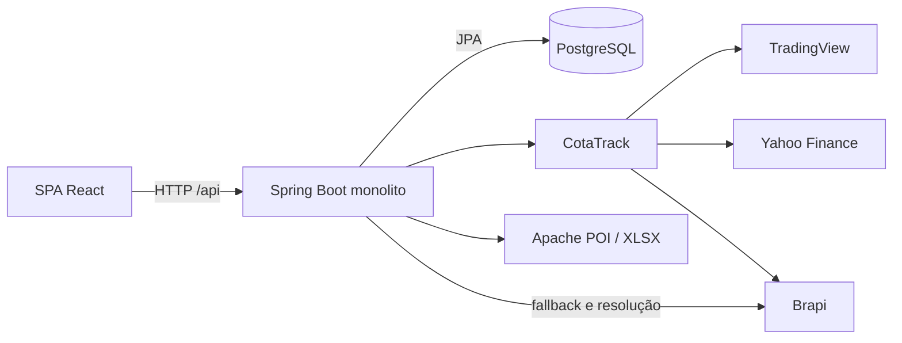

# Investize: auditoria de engenharia e primeiro ciclo de melhorias

Data: 27/10/2026. Cenário: até 100 usuários cadastrados e 10–15 simultâneos.

## Resumo executivo

A direção adequada é **uma SPA React, um monólito Spring Boot e PostgreSQL**.
Não há evidência de necessidade de serviços distribuídos. O principal risco atual
é a confiabilidade do dado financeiro e de seus fluxos de escrita, não capacidade
de CPU ou ausência de infraestrutura enterprise.

Este relatório reúne os entregáveis de arquitetura, produto, problemas,
performance, UI/UX, benchmark, segurança, observabilidade e roadmap.
O primeiro ciclo foi implementado nos dois repositórios, sem novas dependências.

Resultados verificados:

- Metas parciais continuam permitidas, por decisão explícita do usuário, mas
  soma de classes e soma de ativos em cada classe não podem superar 100%.
- Validações de lista agora devolvem HTTP 400 no contrato de erros da API,
  em vez de HTTP 500. Elementos nulos na lista de metas de ativos são rejeitados.
- Percentuais de resultado financeiro são arredondados somente no fim.
  Investimento `0.0000` não causa mais divisão por zero nos resumos.
- Páginas secundárias são carregadas sob demanda, mantendo a navegação visível.
  Falhas de carregamento/renderização possuem recuperação explícita.
- JS inicial completo: aproximadamente **490,58 → 408,69 kB**, ou
  **147,82 → 127,02 kB gzip: redução de 14,1% gzip**.
  Não confundir com a redução de 33,2% apenas do arquivo de entrada.
- Frontend: 49 testes unitários e 18 E2E aprovados; build/type-check e lint aprovados.
- Backend: suíte final com 69 testes descobertos, 68 aprovados e um ignorado
  preexistente, sem falhas. Oito casos parametrizados exercitam o contrato de metas.
  A validação final está consolidada na seção 10.

### Alcance e limitações

Foram inspecionados os dois repositórios, seus manifests, rotas, camadas centrais,
persistência, migrations, integrações e jornadas. O profiling disponível foi
executado **antes das alterações funcionais**, começando por build, testes e browser.

Foram percorridas 16 rotas em desktop e mobile no modo demonstração. Os E2E
incluem uma jornada API com transporte interceptado, não um servidor real.
Não foram alterados dados da carteira real nem executadas cargas sobre o banco
existente. O preview de produção utilizado para medir scripts foi encerrado.

**Não estão concluídos:** pentest, inventário de CVEs, validação de permissões de
produção, profiling de CPU/heap da API real, p95 sob 15 usuários, planos de execução
PostgreSQL, auditoria WCAG completa e avaliação de todos os estados autenticados.
Os documentos abaixo diferenciam medição, defeito reproduzido e hipótese.
Adequação arquitetural não equivale a capacidade de produção certificada.

## 1. Relatório de arquitetura atual

### Frontend

- React 19 + TypeScript + Vite; React Router; Tailwind/CSS.
- TanStack Query para estado remoto; Zustand para preferências e edição mock.
- Recharts para gráficos; D3 hierarchy para mapa de calor; TanStack Virtual para listas.
- Divisão por `app`, `features`, `domain`, `services`, `state`, `shared` e `components`.
- Login/overview permanecem eager; demais páginas usam `React.lazy`.
- O shell fornece o workspace por contexto; não foi observado prop drilling que
  justifique outro gerenciador de estado.
- O adapter centraliza transporte, renovação de sessão e conversão DTO → domínio.

Evidências: [arquitetura frontend](../../investment-app-frontend/docs/FRONTEND-ARCHITECTURE.md),
[router](../../investment-app-frontend/src/app/AppRouter.tsx),
[adapter](../../investment-app-frontend/src/services/portfolioApi.ts),
[workspace](../../investment-app-frontend/src/features/portfolio/hooks/usePortfolioData.ts).

### Backend

- Java 21, Spring Boot 3.3.1, MVC/REST, Security/JWT, Validation, JPA/Hibernate.
- Camada HTTP em `infrastructure/web`; casos de uso em `application/service`;
  entidades e interfaces Spring Data em `domain`.
- DTOs de entrada/saída e um contrato central de erros.
- Serviços de movimentações, consolidação, metas, preço teto, sugestões,
  concentração, rebalanceamento, compartilhamento e importação XLSX.
- `BigDecimal` nas regras financeiras; fonte de verdade de produção no servidor.
- CotaTrack é uma dependência `1.0-SNAPSHOT`, complementada por Brapi e mecanismos
  locais de cache/circuit breaker/rate limiter.

### Banco

- PostgreSQL nos ambientes locais documentados; H2 compatível com PostgreSQL nos testes.
- Flyway V1–V10; Hibernate valida o schema.
- Relações principais:

```text
usuário -> carteiras -> movimentações
                  -> metas de classe -> metas de ativo
                  -> preferências/preço teto -> histórico de alterações
                  -> compartilhamentos
                  -> histórico de importação B3
catálogo de tickers -> classificação e metadados compartilhados
```

### Infraestrutura

- Compose local recomendado: PostgreSQL 17, volume próprio, healthcheck,
  bind em loopback, porta 5433; API local em 8086.
- Compose alternativo usa `postgres:latest`, porta 5432 e nome global de container:
  menor previsibilidade e mais possibilidade de conflito entre projetos.
- Frontend usa proxy de desenvolvimento `/api`; um deployment de produção precisa
  configurar esse encaminhamento no servidor de origem, não depender do proxy Vite.
- Workflow backend executa Maven em Java 23; release efetivo do projeto é 21.
- Nenhum desenho de produção/backup/restauração foi comprovado nesta auditoria.
- Cache existente é local ao processo; não se propõe Redis nem outro cache distribuído.

### Integrações e acoplamentos



- A camada de aplicação ainda conhece `BrapiClient`, tipos CotaTrack e JPA.
  Há portas `MarketQuoteProvider`/`MarketTickerProvider`, mas a inversão de
  dependências é parcial. Não reescrever tudo em arquitetura hexagonal.
- O cache remoto do frontend e as preferências locais têm fronteiras documentadas,
  mas os rascunhos de metas exigem cuidado ao trocar carteira e ao salvar.
- Leitura de resumo pode consultar fornecedores e salvar metadados de ticker:
  consulta, enriquecimento e persistência ficam acoplados.
- Algumas transações abrangem I/O externo; isso pode prolongar retenção de conexão.

### Pontos fortes

- Estrutura por features no frontend e responsabilidades reconhecíveis no backend.
- DTOs explícitos; controle por proprietário exercitado por testes de integração.
- Migrations versionadas, constraints e índices relevantes já presentes.
- Busca com debounce, listas virtualizadas e gráficos já separados por import dinâmico.
- Batch de cotações e de consulta de tickers já evita o N+1 mais óbvio por posição.
- Sugestões com orçamento, unidades inteiras, justificativas, teto e freshness.
- Compartilhamentos possuem testes de comportamento e de revogação/expiração.

### Riscos arquiteturais

1. Dado financeiro degradado pode parecer válido quando cotação vira zero.
2. Edição manual de posição usa duas requisições independentes, não uma operação atômica.
3. Dependência SNAPSHOT pode impedir reprodução de CI em máquina limpa.
4. H2 não valida locking, comportamento PostgreSQL nem planos de execução reais.
5. Backup/restauração, monitoramento e processo de deploy ainda precisam de evidência.

**Decisão:** manter o monólito e as ferramentas atuais. Sim, continua simples
para equipe pequena, 100 usuários e 10–15 simultâneos; não criar componentes
distribuídos para resolver problemas locais de consistência.

## 2. Produto e mapa de funcionalidades

### Problema e público

O Investize organiza posições e movimentações de investidores individuais,
mostra concentração e diferença para metas e auxilia a planejar aportes/vendas.
O público aparente é o investidor brasileiro que quer substituir planilhas,
entender sua distribuição e tomar decisões intencionais. Essa identificação
é inferida dos fluxos e textos; pesquisa com usuários ainda não foi realizada.

O sistema **registra movimentações e simula decisões**. Não integra execução
de ordens na corretora. Algumas confirmações de rebalanceamento registram vendas
na carteira; isso é diferente da confirmação meramente local de um aporte.

### Jornadas

1. Cadastro/login → escolher/criar carteira → cadastrar/importar movimentações.
2. Overview → classe → ativo → compra/venda → revisão → registro.
3. Metas → elegibilidade/preço teto → simulação → entender alocação e saldo.
4. Concentração/mapa de calor → identificar exposição → rebalancear → revisar vendas.
5. Configurações → trocar/renomear/excluir carteira → logout.

### Mapa funcional

| Funcionalidade | Objetivo | Fluxo | Dependências | Riscos | Melhoria |
|---|---|---|---|---|---|
| Sessão e carteiras | Separar os dados de cada investidor | Login → seleção → workspace | JWT, API, usuário/carteira | Sessão expirada; recuperação de conta não avaliada | Validar expiração, reentrada e recuperação |
| Visão geral | Entender patrimônio e resultado | Resumo → filtros/ordenação → ativo | Consolidação, cotações, metas | Zero pode significar falta de cotação | Estado explícito de dado indisponível |
| Compra/venda | Manter posição correta | Ativo → valores → revisão → confirmar | Catálogo, validação, movimentos | Concorrência e duplo envio precisam teste dedicado | Proteção contra duplicação e testes de concorrência |
| Histórico | Auditar operações | Listagem de movimentos | API paginada | UI só pede página 0 de 100 itens | Navegação entre páginas e ordenação estável |
| Importação XLSX | Migrar planilhas/B3 | Origem → arquivo → processamento → resultado | POI, parsers, fornecedores, banco | Snapshot substitutivo; idempotência e falha parcial | Prévia, contagens corretas e confirmação destrutiva |
| Metas | Expressar distribuição desejada | Classes → ativos → salvar | Allocations, workspace | Soma acima de 100%; divergência entre camadas | Corrigido neste ciclo; parcial não é normalizado |
| Preço teto/elegibilidade | Restringir candidatos | Editar valor/habilitar → autosave | Preferências, auditoria, API | Múltiplas gravações concorrentes; falta de feedback | Estado salvando/salvo/falhou por operação |
| Sugestão de aporte | Distribuir valor com regras explicáveis | Informar orçamento → calcular → revisar | Metas, teto, quotes frescas, motor | Dado faltante; expectativas de ordem real | Mostrar origem/idade da cotação de forma consistente |
| Rebalanceamento | Comparar exposição e planejar vendas | Modo → plano → revisão → registro | Cálculo servidor e movimentos | Registro de várias vendas não é atomicidade global | Explicitar resultado parcial e impedir reenvio indevido |
| Concentração e heatmap | Entender risco e variação | Agrupar → inspecionar → ativo | Holdings, cotações, classificação | Indicador heurístico não equivale a análise profissional | Explicação dos limites e alternativa textual |
| Compartilhamento | Permitir leitura consentida | Criar → consumir snapshot → revogar | API pública e token de compartilhamento | Superfície pública exige revisão dedicada | Backend existe; jornada equivalente não está no router SPA |
| Configurações | Privacidade e gestão de carteira | Ocultar valores/trocar/renomear/excluir | Preferências locais e API | Exclusão irreversível e estados antigos | Confirmação contextual e testes de dados associados |

Funcionalidades principais: carteira, movimentos, importação, metas e aporte.
Secundárias: visualizações avançadas, exportação Markdown, compartilhamento e
personalizações. Não priorizar novas análises sofisticadas antes de confiança no dado.

## 3. Relatório de problemas técnicos

Legenda: **confirmado** = leitura direta ou teste reproduzível;
**hipótese** = precisa de medição/ensaio adicional. P0 = próximo ciclo antes de
confiar no fluxo afetado; P1 = alta prioridade; P2 = melhoria; P3 = oportunidade.

| ID | Problema e evidência | Impacto | Esforço | Ganho esperado | Prioridade / estado |
|---|---|---|---|---|---|
| T01 | Resumos dividiam e arredondavam antes de multiplicar por 100 | Ex.: 12,50% virava 13%; perda de precisão na apresentação financeira | Baixo | Erro máximo de arredondamento cai para 0,005 p.p. na regra de duas casas | P1 / corrigido |
| T02 | `BigDecimal.equals(ZERO)` falhava para `0.0000` | Divisão por zero, indisponibilidade do resumo | Baixo | Fluxo de custo zero deixa de gerar erro aritmético | P1 / corrigido |
| T03 | Metas validavam campos, não a soma | Distribuição impossível acima de 100% | Baixo/médio | Regra única coerente no browser e API | P1 / corrigido |
| T04 | Handler genérico convertia `HandlerMethodValidationException` em 500 | Cliente não consegue distinguir entrada inválida de defeito servidor | Baixo | Contrato 400 + código `VALIDATION_FAILED`; retorno inválido continua 500 | P1 / corrigido |
| T05 | Páginas não utilizadas integravam o JS inicial | Mais download e parse na entrada | Baixo | Menos 14,1% gzip no conjunto inicial medido | P2 / corrigido |
| T06 | Dois testes de integração registravam ticker via provedor real | Rede/certificado interferiam na suíte; alertas PKIX no baseline | Baixo | Dois fluxos passam a usar provider mockado | P1 / corrigido |
| T07 | Editar posição faz SELL e depois BUY em duas chamadas | Se BUY falhar, SELL permanece; alteração sintética de histórico | Médio | Uma operação servidor com semântica de correção definida | P0 / pendente |
| T08 | Quote ausente pode ser transformada em preço zero no resumo | Patrimônio/resultado enganoso, embora cálculo de sugestões seja mais estrito | Médio | Diferenciar indisponível de preço real e evitar falso −100% | P1 / pendente |
| T09 | Histórico busca somente primeira página de 100 | Operações antigas ficam inacessíveis na UI | Baixo/médio | Histórico integral acessível sem carregar tudo | P1 / pendente |
| T10 | Importação apresenta sucesso genérico e chama movimentações de ativos | Contagens e falhas parciais podem confundir o usuário | Baixo | Resultado alinhado a status/negociações/duplicadas | P1 / pendente |
| T11 | `AssetSummaryService` concentra batch, fallback, descoberta, escrita e DTO | Acoplamento e custo de testes/manutenção | Médio | Separar apenas enriquecimento e política de indisponibilidade | P2 / pendente |
| T12 | `PortfolioPages` e `ContributionPages` agrupam várias jornadas; JSX denso | Mudanças cruzadas mais arriscadas; chunks por módulo, não por tela | Médio | Extrair quando houver mudança concreta; não fragmentar tudo agora | P2 / pendente |
| T13 | Categoria → coleção lazy de allocations | Possível N+1 limitado ao número de classes | Baixo após medir | Contagem de SQL estável, se demonstrar custo | P2 / hipótese de custo |
| T14 | Summary/concentration/classes podem reconsolidar mesma carteira | Trabalho e I/O repetidos por navegação | Médio | Reusar resultado por requisição onde aplicável | P2 / medir antes |
| T15 | Dependência CotaTrack SNAPSHOT sem resolução remota comprovada | Build local pode passar e CI limpa falhar | Médio | Build reproduzível com versão publicada/imóvel | P1 / pendente |
| T16 | Falha de importação salva histórico e lança erro na mesma transação | Histórico de falha pode sofrer rollback junto com operação | Médio | Teste de rollback e política de histórico explícita | P1 / hipótese a validar |
| T17 | README dizia Java 23 obrigatório e apenas três categorias | Onboarding errado apesar do código suportar Java 21 e sete categorias | Baixo | Documentação coerente com manifests e adapter | P2 / corrigido |
| T18 | Plano PostgreSQL/capacidade/backup sem ensaio | Falhas operacionais só aparecem no uso real | Médio | Recuperação testada e orçamento de latência conhecido | P1 / pendente |

Evidências centrais:
[resumo de ativo](../src/main/java/dev/jaoow/investmentapp/application/service/summary/AssetSummaryService.java),
[resumo da carteira](../src/main/java/dev/jaoow/investmentapp/application/service/summary/PortfolioSummaryService.java),
[metas servidor](../src/main/java/dev/jaoow/investmentapp/application/service/AllocationService.java),
[handler](../src/main/java/dev/jaoow/investmentapp/infrastructure/web/GlobalExceptionHandler.java),
[edição da posição](../../investment-app-frontend/src/features/portfolio/pages/PortfolioPages.tsx),
[histórico UI](../../investment-app-frontend/src/features/portfolio/pages/MovementsPage.tsx),
[importação B3](../src/main/java/dev/jaoow/investmentapp/application/service/b3/B3NegotiationImportService.java).

### SOLID, DRY, KISS, estado e renderizações

- Há serviços focados e interfaces para mercado; a maior oportunidade SOLID está
  no resumo/enriquecimento, não em uma reestruturação global de pacotes.
- A fórmula financeira duplicada foi extraída para um helper pequeno e restrito
  ao pacote de resumos; não foi criada uma biblioteca financeira.
- TanStack Query já é o dono do estado remoto. Não adicionar Redux ou espelhar
  respostas em Zustand. Rascunhos e preferências não devem tornar-se cache paralelo.
- Não há evidência de re-render excessivo que justifique espalhar `memo`/`useMemo`.
  Filtros e somas sobre uma carteira pequena são aceitáveis. Medir com React Profiler
  antes de otimizar esses loops.
- A lista já é virtualizada; o gráfico agrega muitos segmentos. Manter esses
  mecanismos existentes, sem expandir virtualização para formulários pequenos.
- Testes financeiros devem usar valores exatos; comparar apenas se “a tela abriu”
  ou se o teste terminou não detecta erros de percentuais.

## 4. Banco: modelagem, consultas e custos

Os custos abaixo são **estruturais**, não tempos/EXPLAIN medidos.
Não foi alegada a existência de consulta lenta ou full scan real sem plano PostgreSQL.

| Consulta/fluxo | Custo provável | Problema/rastreamento | Sugestão | Impacto |
|---|---|---|---|---|
| Movimentos por carteira/ticker | Proporcional ao histórico selecionado | Índice `(portfolio_id,ticker_symbol)` já existe na V2 | Preservar; medir volume representativo | Evita índice redundante |
| Consolidação da carteira | O(M log M), ordenação de M movimentos em memória | Reprocessada para resumo e outros analytics | Medir com 1k/10k movimentos antes de materializar saldo | Para 100 usuários, processamento local tende a ser suficiente |
| Metas por carteira + ativos | Potencial uma consulta por coleção lazy | `findByPortfolioId` e acesso a `getAssetAllocations` | Contar SQL; se necessário `EntityGraph`/fetch join direcionado | Evitar N+1 sem tornar tudo EAGER |
| Catálogo por holdings | Consulta batch por IDs | `findAllById` já utilizado | Manter batch | Não adicionar consultas por ticker |
| Busca de ticker | `LOWER(symbol) LIKE '%termo%'` não favorece B-tree comum | Full scan é possível e aceitável em catálogo pequeno | Medir antes de índice especializado; não adicionar extensão agora | Menos custo de manutenção |
| Setores/subsetores | Uma busca de subsetor por setor | N+1 explícito no método de catálogo | Consulta única/projeção se esse endpoint demonstrar uso/custo | Otimização local, sem cache distribuído |
| Histórico de teto | Filtro carteira/ticker e ordem temporal | Índice inclui carteira, ticker, data e ID na V4 | Preservar paginação e desempate por ID | Consulta já alinhada ao acesso |
| Histórico de movimentos | Endpoint paginado; frontend fixa `page=0&size=100` | Problema de UX, não ausência de paginação no banco | Expor páginas e usar data + ID na ordenação | Histórico completo com consumo limitado |
| Histórico B3 atual | V9 recria tabela sem os índices da estrutura V8 removida | Não supor que os índices antigos ainda existam | EXPLAIN em dados representativos; avaliar `(portfolio_id, imported_at, id)` | Evita criar índice sem uso comprovado |
| Deduplicação B3 | Busca por carteira e hashes; coluna external reference é globalmente UNIQUE | Validar semântica entre carteiras e importações concorrentes | Testes de duas carteiras e de repetição concorrente | Confiabilidade antes de velocidade |
| Troca de metas | Exclusão + flush + inserção em transação | Rejeição deve preceder exclusão | Já preservado e testado neste ciclo | Requisição inválida não apaga metas anteriores |

Relacionamentos e migrations estão em
[entidades](../src/main/java/dev/jaoow/investmentapp/domain/entity) e
[migrations](../src/main/resources/db/migration).

Não foram adicionados índices, novas tabelas ou migrações neste ciclo.
Próximo ensaio: PostgreSQL isolado, dados sintéticos e `EXPLAIN (ANALYZE, BUFFERS)`
apenas sobre consultas de leitura seguras. Planejar separadamente queries mutáveis,
locking, restauração e permissões.

## 5. Relatório de performance

### Baseline anterior à implementação

| Medida | Antes | Depois | Interpretação |
|---|---:|---:|---|
| Entry JS | 490,58 kB / 147,82 gzip | 327,50 kB / 100,19 gzip | Não representa sozinho todos os scripts iniciais |
| JS inicial, incluindo preloads | 490,58 kB / 147,82 gzip | 408,693 kB / 127,024 gzip | −16,7% bruto; **−14,1% gzip** |
| Chunk gráfico | 316,35 kB / 93,32 gzip | 316,38 kB / 93,33 gzip | Continua lazy; praticamente inalterado |
| CSS | 67,98 kB / 14,62 gzip | 68,00 kB / 14,63 gzip | Sem melhoria relevante |
| Total de JS gerado | ~822,96 kB | 831,273 kB | ~1% maior; benefício é adiar trabalho, não eliminar funcionalidades |
| Quantidade de chunks JS | 3 | 23 | Trade-off de granularidade e requisições; sem política manual de chunks |
| Build Vite, uma execução | 1,17 s | 1,13 s final | Variação pequena; não alegar ganho de build |
| Vitest | 45 aprovados | 49 aprovados | Cobertura funcional, não benchmark |
| E2E | 14/18 aprovados | 18/18 aprovados | Regressões antigas de contrato de metas resolvidas |
| Maven offline, suíte | 47,829 s; 56 descobertos, 1 ignorado | 25,715 s; 69 descobertos, 1 ignorado | Sem comparação causal: aquecimento e contextos diferem |

O cálculo de gzip usou compressão local dos artefatos; servidor de produção deve
habilitar compressão para materializar a economia de rede.

### Confirmação no browser de produção

Preview Vite temporário em loopback, Chromium com contexto novo, rota `/login`,
fontes externas bloqueadas apenas no ensaio para reduzir variação. Scripts recebidos:

```text
index-22PvL-Dk.js          327500 bytes
clsx-BbohabLV.js            9267 bytes
PageHeading-2xo1qrvz.js    71926 bytes
total                    408693 bytes
```

Nenhum chunk de página secundária nem Recharts foi carregado nessa entrada.
`DOMContentLoaded` foi 79 ms em uma execução local. **Não há baseline equivalente
anterior de produção**, portanto não se afirma redução de latência, LCP ou INP.
Os nomes dos arquivos são hashes deste build, não interfaces estáveis.

### Browser de desenvolvimento e responsividade

16 rotas × duas larguras: 32 verificações de heading/estado e largura documental.
Desktop 1280 px; mobile solicitado 393 px, largura efetiva reportada ~394 px.
Não foi detectado overflow horizontal global nesses estados.
`DOMContentLoaded` variou aproximadamente 267–378 ms no Vite aquecido.
Esses números não são tempos de negócio, não incluem conclusão de todas as queries,
e não são comparáveis ao preview de produção nem a uma conexão móvel real.

### Classificação

| Nível | Item | Evidência / decisão |
|---|---|---|
| Crítico | Nenhum gargalo de capacidade comprovado | Não inventar p95, uso de CPU ou limites do banco |
| Alto, risco | Fornecedores/fallback em transações de resumo | Caminho confirmado em código; latência ainda não medida |
| Médio | JS inicial e código de rotas desnecessário na entrada | Medido e melhorado; avaliar navegação em rede lenta no próximo ciclo |
| Médio, risco | Repetição de consolidação/queries de metas | Medir SQL/endpoint antes de alterar fetch/caching |
| Baixo | Micro-otimização de filtros e somas React | Sem React Profiler que a justifique |
| Baixo | Assets ilustrativos e tree shaking | Build funciona; nenhuma redução de imagens foi creditada |

### Próximo protocolo de profiling, sem instalar uma plataforma

1. API e PostgreSQL isolados; dados fictícios com carteiras pequenas e 1k/10k movimentos.
2. Medir endpoints overview, movimentos, metas, simulação e concentração com
   1, 5 e 15 usuários virtuais; separar cache frio/quente e falha de fornecedor.
3. Registrar p50/p95, erros, quantidade de SQL, conexão ocupada e tempo externo.
4. JFR curto para CPU/alocação/GC, sem gravação de payload financeiro.
5. `EXPLAIN` das consultas dominantes; React Profiler e Web Vitals em build de produção.
6. Orçamento inicial proposto, não resultado: p95 <500 ms em leitura local sem
   fornecedor; documentar orçamento separado de mercado externo e timeout total;
   LCP <2,5 s e INP <200 ms em dispositivo/rede definidos.
7. Só otimizar gargalos encontrados; não criar cache distribuído, filas ou
   projeções persistentes preventivamente.

## 6. Relatório de UI/UX

### Método

Inspeção de rotas, código, árvore acessível, screenshot do heatmap e E2E desktop/mobile.
Todos os mockups abaixo são **conceituais em texto**, não layouts finais.
Testes de contraste, leitor de tela e estados de produção continuam pendentes.
Recomendações visuais não são alegações de falha WCAG comprovada.

| Tela | Problema/risco observado | Impacto | Sugestão | Mockup conceitual | Prioridade |
|---|---|---|---|---|---|
| Login/cadastro/seleção | Navegação existente; recuperação de conta não evidenciada nos fluxos avaliados | Bloqueio de retorno pode exigir suporte | Projetar recuperação após definir política de conta | `Entrar → erro junto ao campo → recuperar acesso` | P2 |
| Overview | Resultado rotulado como período pode ser confundido com performance total histórica | Interpretação financeira errada | Explicar custo atual, valorização não realizada e origem da cotação | `Patrimônio · atualizado em… / Resultado das posições abertas (?)` | P1 |
| Carteira | Várias ações competem no cabeçalho | Mais esforço de escolha, especialmente mobile | Manter movimentação principal e agrupar secundárias se teste de uso confirmar | `[Nova movimentação] [Mais: importar, copiar, análises]` | P2 |
| Detalhe de classe | Metas e valores têm boa hierarquia, mas dependem de várias leituras | Pode exibir divergência entre resumo e detalhe | Sinalizar atualização/erro parcial e manter retorno para carteira | `Classe / Atual → Meta / Ativos / Atualizando…` | P2 |
| Detalhe de ativo | Edição substitui posição via SELL + BUY separados; texto de demonstração aparece no JSX independentemente do modo | Risco de escrita parcial e comunicação inadequada no modo API | Priorizar correção atômica e texto por origem real/mock | `Ativo / Dados de… / Corrigir posição → revisão explícita` | P0 |
| Nova movimentação | Wizard tem revisão e feedback; busca de ticker usa catch amplo em caminho de cadastro | Erro de infraestrutura pode parecer ticker inexistente | Distinguir 404 de falha de consulta e permitir nova tentativa | `Buscar → indisponível [Tentar] / sem resultado [Cadastrar]` | P1 |
| Movimentações | Apenas 100 registros; sem controles para próximas páginas | Histórico incompleto | Mostrar total, páginas e tipo/quantidade/preço/data | `1–25 de 142 / [Anterior] [Próxima]` | P1 |
| Importação | Snapshot destrutivo tem aviso, mas falta revisão/consentimento específico; resultado sempre genérico | Perda acidental de histórico e falsa compreensão do resultado | Prévia + confirmação de substituição + status real | `Validar → 120 novas / 8 duplicadas / revisar → importar` | P1 |
| Concentração | Limites são heurísticos e podem parecer recomendação universal | Excesso de confiança | Explicar limites de alerta e dados não classificados | `Exposição / Limites usados (?) / setores não informados` | P2 |
| Mapa de calor | Cor + área concentram informação; blocos pequenos e touch requerem avaliação | Leitura difícil e possível dependência da visão | Manter números/sinais e oferecer tabela equivalente; validar teclado | `[Mapa] [Lista] / ticker, peso, variação, horário` | P2 |
| Metas | Permitida soma acima de 100%; erro não explicava a soma | Salvamento inválido | Corrigido: soma validada e erro contextual; parciais mantidas | `95% definido / até 100% / [Salvar]` | P1, parte corrigida |
| Aportes (menu) | Cards explicam os fluxos e há disclaimer | Bom reconhecimento, mas status de configuração fica distante | Acrescentar resumo somente se reduzir dúvidas reais | `Metas ✓ / tetos pendentes 2 / Simular` | P3 |
| Elegibilidade/tetos | Autosave tem erro global, sem estado individual de progresso | Usuário não sabe se pode sair ou se alteração persistiu | Feedback salvando/salvo/falhou junto à linha | `PETR4 [teto] · Salvando… → Salvo / Tentar novamente` | P1 |
| Simulador | Explicações e saldo existem; separar simulação de operação continua essencial | Usuário pode interpretar confirmação como ordem | Exibir data/fonte e próxima ação sem prometer compra | `Simulação / fonte+horário / sobra / registrar manualmente` | P1 |
| Rebalanceamento | Confirmação registra vendas; lote pode ser parcialmente salvo, e código já informa quais foram registradas | Repetição manual pode duplicar operação | Evidenciar registrados/pendentes e testar interrupção/reenvio | `3 registradas / 1 pendente / revisar somente pendente` | P1 |
| Configurações | Exclusão usa `window.confirm`; troca e rename têm feedback textual | Confirmação pouco contextual; foco/feedback merecem revisão | Dialog com nome e consequência, sem mudar a semântica agora | `Excluir “Principal”? / dados afetados / Cancelar / Excluir` | P2 |

### Nielsen e acessibilidade transversal

- **Visibilidade:** estados loading/erro existem. Agora o loading tem `role=status`
  e falhas de chunks têm mensagem e ação, em vez de tela quebrada.
- **Controle:** shell e menu permanecem utilizáveis durante carregamento/falha da rota.
  A fronteira de erro reseta na troca de pathname.
- **Consistência:** componentes locais e tokens escuros já dão identidade comum.
  JSX extenso com estilos inline merece extração apenas quando a tela for revisada.
- **Prevenção:** soma financeira validada antes do envio e no servidor; próximo
  foco é confirmação de importação/edição destrutiva.
- **Feedback:** não tratar todo erro de API como vazio ou ausência do ativo.
- **Teclado:** dialogs possuem nomes/aria-modal, mas foco preso, Escape e retorno
  de foco não estão implementados em todos os dialogs lidos; testar antes de padronizar.
- **Contraste:** tons cinza e tamanhos pequenos devem ter medição WCAG, não um
  redesign baseado apenas em impressão de screenshot.
- **Responsividade:** estados inspecionados sem overflow global; não prova adequação
  de zoom 200%, traduções, mensagens longas ou todos os conteúdos reais.

## 7. Benchmark e oportunidades

Consulta a páginas públicas oficiais em 27/10/2026. Não se copiou interface,
conteúdo proprietário nem funcionalidade por imitação.

| Referência | Evidência pública consultada | Adaptação adequada ao Investize |
|---|---|---|
| [Investidor10](https://investidor10.com.br/) | Gerenciador consolidado, conexão B3 anunciada, proventos e indicadores, além de ferramentas fiscais | Melhorar importação e explicação da origem dos dados; proventos depois de garantir posições corretas |
| [Status Invest](https://statusinvest.com.br/) | Separação por ações/FIIs/BDRs/stocks e calendários de eventos/proventos | Clareza de categorias e, futuramente, agenda contextual; não transformar o app em portal de mercado |
| [Sharesight](https://www.sharesight.com/) | Consolidação, integração com corretoras, dividendos e planos com limites explícitos | Onboarding com primeira carteira, transparência de cobertura e limites; não prometer “rentabilidade real” sem eventos/fluxos |

O site Kinvo foi consultado, mas o conteúdo retornado não forneceu evidência
comparável de produto. Foi excluído da comparação, em vez de presumir capacidades.
O endereço específico `/carteira/` do Investidor10 retornou 404; utilizou-se sua home.
Preços comerciais não foram usados para decisões de engenharia.

Oportunidades:

1. **Agora:** onboarding de carteira confiável, prévia de importação, estado de
   atualização de cotação e distinção entre simulação, registro e ordem.
2. **Médio prazo:** proventos/eventos corporativos, reconciliação e performance
   explicitamente definida. Levantar demanda com os primeiros usuários.
3. **Futuro:** benchmark CDI/índices, integrações automáticas e compartilhamento
   completo no frontend, somente com custo/dados/licenças/consentimento esclarecidos.

Não priorizar fiscal completo, automação com corretoras ou análises sofisticadas
apenas porque concorrentes maiores oferecem essas funções.

## 8. Relatório de segurança

**Status: revisão incompleta/inconclusiva.** Não há vulnerabilidade explorável
validada para apresentar nesta entrega. Isso **não** significa que o sistema
esteja seguro ou que todos os fluxos tenham sido cobertos.
Não foi realizado pentest ou teste adversarial em dados/serviços de terceiros.

| # | Severity | File | Lines | Vulnerability | Confidence |
|---|----------|------|-------|---------------|------------|
| — | — | — | — | Nenhuma vulnerabilidade validada; cobertura de segurança insuficiente para conclusão | — |

### Evidências limitadas disponíveis

- Testes de integração exercitam proprietário versus outro usuário em carteiras,
  configurações e histórico de teto; não substituem matriz de todos os endpoints.
- Há contrato central de erros e DTOs de validação. Nesta entrega, testes
  demonstraram e corrigiram uma resposta 500 indevida para entrada inválida.
  Esse defeito de confiabilidade não foi promovido a vulnerabilidade sem exploração.
- O adapter persiste tokens no armazenamento do browser. Isso amplia o impacto
  potencial de um XSS, mas armazenamento local sozinho não comprova XSS.
- Scripts/documentação orientam segredo no backend. Não há atestado de ausência
  de secrets em todo o histórico ou nos bundles/deployments existentes.

### Riscos a verificar, não achados confirmados

| Área | Risco a investigar | Impacto potencial | Verificação/correção condicionada | Prioridade |
|---|---|---|---|---|
| Autorização | Cobertura de ownership em todos os GET/POST/PUT/DELETE e imports | Leitura/alteração de carteira alheia | Matriz usuário A/B, ID inexistente e endpoints públicos | P1 |
| Sessão | Refresh, revogação, expiração, logout e distinção de tipos de token | Uso indevido de sessão | Testes adversariais isolados; não migrar para cookies sem avaliar CSRF/CORS | P1 |
| Browser | XSS + acesso a tokens persistidos | Sequestro de sessão | Revisar sinks/URLs, política CSP e sanitização conforme uso real | P1 |
| Upload | Arquivos excessivos, ZIP/XLSX hostil, headers e células inesperadas | Exaustão de memória/CPU ou inconsistência | Ensaios de limites com arquivos sintéticos e rollback | P1 |
| Banco | Usuário de runtime com privilégios indevidos; ausência de backup restaurável | Exposição/perda de dados | Revisar grants e restauração em ambiente autorizado | P1 |
| Dependências | Versões sem inventário de vulnerabilidades e SNAPSHOT | Vulnerabilidade ou build não reproduzível | Scanner na CI com metadados autorizados e triagem de reachability | P1 |
| Compartilhamento | Validade, revogação, disclosure e comportamento sem valores | Exposição não consentida | Testar snapshots e token expirado/revogado sem dados reais | P1 |
| Logs | Possível presença de tokens, payloads, e-mails ou mensagens de fornecedor | Dados pessoais/sensíveis em logs | Revisar emissão/retenção; testar redaction; não logar corpos/Authorization | P1 |
| Infra | Configurações locais reutilizadas em ambiente compartilhado | Exposição de serviço ou credenciais de desenvolvimento | Configuração própria de produção, TLS e rede controlada | P1 |

Nenhuma mudança de autenticação, permissão, política de banco ou segredo foi
feita sob suposição. Uma revisão de segurança completa continua sendo gate
para uma declaração de prontidão de produção.

## 9. Observabilidade mínima viável

### Existente e comprovado em código

- SLF4J com logs de exceção no handler global.
- Logs de batch de cotação com quantidade solicitada/resolvida, fornecedor,
  cache e duração (`durationMs`).
- Erros padronizados com timestamp/status/code/details.
- Histórico de alterações de preço teto e importações.
- A nova fronteira React registra falha no console e apresenta recuperação ao usuário.

### Não comprovado

Métricas HTTP agregadas, error tracking centralizado, correlação ponta a ponta,
dashboards, alertas, tracing distribuído e retenção/redaction operacional.
Console do browser não equivale a error tracking.

### Proposta mínima

1. Um identificador de requisição gerado no servidor, devolvido em header e logs;
   aceitar IDs externos apenas com validação de tamanho/formato.
2. Log de acesso com método, rota normalizada, status e duração. Sem corpos,
   tokens, parâmetros financeiros ou e-mail. Evitar cardinalidade por carteira/ticker.
3. Medir p95/5xx e duração de fornecedor. Começar com logs agregados e monitor
   externo simples de disponibilidade; não instalar um cluster de observabilidade.
4. Alertar indisponibilidade contínua e falhas de backup; definir retenção curta
   compatível com necessidades operacionais/privacidade.
5. Se o time não conseguir acompanhar erros do browser, avaliar um único error
   tracker com redaction e aprovação de envio de dados. Nenhum SaaS foi configurado.
6. Healthcheck mínimo deve distinguir processo saudável de cotação indisponível.
   Não expor métricas administrativas publicamente.

Para a escala prevista, não há justificativa para tracing distribuído,
OpenTelemetry Collector, Kafka, Elasticsearch ou plataforma enterprise agora.

## 10. Execução: causa, código, ganho, risco e validação

### Ciclo A — metas e contrato HTTP

**Problema:** totais acima de 100% eram aceitos; docs e E2E antigos exigiam
exatamente 100%. O usuário definiu: parciais são permitidas, nunca acima de 100%.

**Causa:** validação individual sem invariantes de soma; generic catch do handler
interceptava a exceção de validação de métodos do Spring MVC e respondia 500.

**Solução/código:** totais verificados antes de apagar metas existentes;
erro de soma contextual no browser, API independente e erros de entrada como 400.
Elementos nulos de assets são rejeitados por Bean Validation.

```typescript
export function isAllocationValid(values: number[]) {
  return values.every((value) => Number.isFinite(value) && value >= 0 && value <= 100)
    && totalPercentage(values) <= 100 + Number.EPSILON * 100 * values.length
}
```

A tolerância é somente para ruído de ponto flutuante, não uma margem de 0,01 p.p.
O servidor calcula com BigDecimal e limite exato.

Arquivos:
[helper e testes frontend](../../investment-app-frontend/src/features/goals/allocation.ts),
[tela](../../investment-app-frontend/src/features/goals/pages/GoalsPage.tsx),
[serviço](../src/main/java/dev/jaoow/investmentapp/application/service/AllocationService.java),
[DTO](../src/main/java/dev/jaoow/investmentapp/application/dto/request/CategoryAllocationRequest.java),
[handler](../src/main/java/dev/jaoow/investmentapp/infrastructure/web/GlobalExceptionHandler.java),
[integração POST/PUT](../src/test/java/dev/jaoow/investmentapp/AllocationValidationIntegrationTests.java).

**Ganho:** invariantes verificadas em duas camadas, rejeição de 100,01%, ausência
de remoção de metas em substituição inválida e erros distinguíveis pelo cliente.
**Risco:** carteiras que já possuam totais inválidos precisam correção manual;
nenhuma migração de dados foi executada. O percentual não definido não é redistribuído
e não equivale a uma posição real de caixa.

**Validação:** testes parciais/exatos/zero, soma de categorias, soma de ativos
inclusive categoria zero, negativos, nulos, coleções vazias e preservação de metas.
E2E verifica soma de 105%, parcial de 95% e total inválido por ativo.
Erros de validação de retorno do servidor continuam tratados como defeito 500.

### Ciclo B — carregamento de páginas e recuperação

**Problema/causa:** imports estáticos de páginas secundárias no router faziam
todo esse código participar da carga inicial.

**Solução:** `React.lazy` por módulo existente; Suspense e boundary em torno
do outlet, mantendo shell/menu. Não criar política manual de vendors.

```tsx
const GoalsPage = lazy(() => import('../features/goals/pages/GoalsPage')
  .then((module) => ({ default: module.GoalsPage })))
```

Arquivos:
[router](../../investment-app-frontend/src/app/AppRouter.tsx),
[fronteira de rota](../../investment-app-frontend/src/app/RouteContent.tsx),
[testes de pending/rejection](../../investment-app-frontend/src/app/RouteContent.test.tsx),
[loading acessível](../../investment-app-frontend/src/shared/components/LoadingState.tsx).

**Ganho:** −14,1% gzip inicial completo medido. **Risco:** mais chunks e um round
trip na primeira entrada em cada módulo. O total de JS aumenta aproximadamente 1%.
O deploy deve preservar assets antigos durante transição e servir HTML com política
de cache apropriada; em falha, recarregar ou navegar está disponível.
O agrupamento de telas do mesmo módulo evita uma refatoração desnecessária.

**Validação:** build/lint/type-check; testes de loading, falha e navegação;
18 E2E; confirmação dos três scripts realmente recebidos no preview.

### Ciclo C — precisão e confiabilidade dos resumos financeiros

**Problema:** `25 / 200`, arredondado primeiro, produzia 13% em vez de 12,50%.
`0.0000.equals(BigDecimal.ZERO)` é falso, permitindo divisão por zero.

**Solução:** regra pequena compartilhada por resumo de ativo e carteira.

```java
static BigDecimal percentageChange(BigDecimal investedAmount, BigDecimal profitOrLoss) {
    return investedAmount.signum() == 0 ? BigDecimal.ZERO
            : profitOrLoss.multiply(BigDecimal.valueOf(100))
                    .divide(investedAmount, 2, RoundingMode.HALF_UP);
}
```

Arquivos:
[SummaryMath](../src/main/java/dev/jaoow/investmentapp/application/service/summary/SummaryMath.java),
[testes carteira](../src/test/java/dev/jaoow/investmentapp/application/service/summary/PortfolioSummaryServiceTests.java),
[testes ativo](../src/test/java/dev/jaoow/investmentapp/application/service/summary/AssetSummaryServiceTests.java).

**Ganho:** erro de arredondamento final limitado a 0,005 p.p.; no caso 12,5%,
correção de 0,5 p.p. O valor financeiro absoluto não é alterado por essa fórmula.
**Risco:** números exibidos podem mudar e snapshots precisam refletir a precisão
correta. Retorno sobre custo zero continua zero por convenção existente, não
representa retorno financeiro matematicamente definido ou performance TWR/IRR.

**Validação:** antes da correção, quatro assertions de precisão falharam e dois
casos geraram divisão por zero. Depois, casos positivos, negativos e zero com
escala passam nas duas superfícies. Também foi verificado custo zero sem quotes.

### Ciclo D — testes herméticos e documentação

**Problema/causa:** testes de registro de ticker acessavam provider real para
enriquecimento; baseline tinha avisos PKIX. README não refletia Java/categorias/metas.

**Solução:** mock da interface já existente em duas classes de integração,
mantendo todo o fluxo HTTP/JPA real sob teste. Docs alinhadas às regras efetivas.

Arquivos:
[teste de movimentos](../src/test/java/dev/jaoow/investmentapp/AssetMovementValidationIntegrationTests.java),
[teste de configurações](../src/test/java/dev/jaoow/investmentapp/AssetSettingsIntegrationTests.java),
[README API](../README.md),
[README SPA](../../investment-app-frontend/README.md).

**Ganho:** esses testes deixam de depender da rede/certificados de fornecedor.
**Risco:** não validam a integração real de mercado, que precisa de teste contratado
separado; não atribuir toda redução de duração da suíte ao mock.
**Validação:** suíte completa aprovada; os avisos PKIX desses fluxos desapareceram.
Warnings de instrumentação Mockito e compatibilidade Flyway/H2 continuam conhecidos.

### Comandos e resultado final

Frontend:

```powershell
npm run build
npm run lint
npm run test
npm run test:e2e
```

Backend:

```powershell
.\mvnw.cmd test
```

O comando Maven padrão desta máquina falhou por HTTP 403 no mirror configurado.
A alternativa que funcionou foi execução **offline**, com settings temporários
vazios para usuário/global, usando os artefatos já disponíveis no repositório
local. Nenhuma configuração global ou configuração do projeto foi alterada
para contornar o ambiente. Esse resultado não prova resolução em CI limpa.

O teste Excel ignorado é um teste manual preexistente que depende de uma planilha
local; não foi habilitado artificialmente nem apresentado como teste aprovado.
Não há commits, push, mudanças de infraestrutura ou novas dependências nesta entrega.

| Validação final | Resultado |
|---|---|
| Maven, suíte inteira após alteração do handler comum | 69 descobertos; 68 aprovados; 1 ignorado; zero falhas/erros |
| Vitest | 49 aprovados em 8 arquivos |
| Playwright desktop + mobile | 18 aprovados |
| TypeScript + build Vite | Aprovado |
| ESLint | Aprovado |
| Preview produção e scripts recebidos | HTTP 200; três scripts iniciais confirmados; preview encerrado |
| Whitespace | Diff validado considerando CRLF preexistente no handler |

## 11. Roadmap, Quick Wins e decisões

### Matriz impacto × esforço

| Quadrante | Itens | Decisão |
|---|---|---|
| Alto impacto + baixo esforço | Precisão financeira, soma de metas, HTTP 400, isolamento de testes, feedback de erro | Primeiro ciclo executado; completar feedback de autosave depois |
| Alto impacto + alto esforço | Edição de posição atômica, importação reconciliada, segurança completa, dados de mercado confiáveis, restauração | Próximo investimento de engenharia; dividir em fluxos testáveis |
| Baixo impacto + baixo esforço | Revisões de textos, estados vazios, nomeação de contagens, agrupamento contextual de ações | Fazer junto à próxima mudança de cada tela |
| Baixo impacto + alto esforço | Reescrita arquitetural, substituição de stack, múltiplos serviços, framework próprio de componentes | Não fazer para a escala atual |

### Próximos ciclos priorizados

Estimativas indicativas para uma pessoa familiarizada com o código, não compromisso
de prazo. Cada item exige critério de aceite antes da implementação.

| Ordem | Horizonte / esforço | Entrega | Critério de aceite / métrica |
|---|---|---|---|
| 1 | Imediato / 1–3 dias | Definir semântica de corrigir posição e operação atômica no servidor; até lá orientar uso de movimentos explícitos | Injetar falha intermediária sem deixar posição parcialmente alterada; testes reais de API |
| 2 | Curto / 1–2 dias | Revisão de segurança com evidências por endpoint e ambiente autorizado | Relatório reproduzível com arquivos/linhas, cenários e matriz A/B; triagem dos achados |
| 3 | Curto / 1–3 dias | Quote indisponível/stale como estado distinto de zero em toda UI | Indisponibilidade não gera falso preço zero nem falso resultado −100%; contrato explícito |
| 4 | Curto / 0,5–1,5 dia | Paginação de movimentos e ordenação determinística | Acessar >100 operações, sem duplicação entre páginas em dataset estável |
| 5 | Curto / 1–3 dias | Prévia e resultado correto de importação | Separar novas/duplicadas/falhas; confirmar snapshot; ensaiar rollback e repetição entre carteiras |
| 6 | Curto / 1–2 dias | Build reproduzível em ambiente limpo e backup restaurável | Dependências resolvidas sem cache pessoal; restaurar dump em banco isolado |
| 7 | Médio / 1–3 dias | Profiling PostgreSQL/API/React e mínimo de observabilidade | Baseline p50/p95/erros com 15 usuários e fonte externa separada; sem payload em logs |
| 8 | Médio / 1–2 dias | UX de autosave/dialogs/teclado e WCAG | Pending e erro por ação, foco/Escape/retorno de foco, contraste medido, mobile e zoom |
| 9 | Médio / conforme demanda | Reduzir N+1 e tamanho de componentes dominantes | Contagem SQL e profiler mostram redução; mesma saída funcional |
| 10 | Futuro / descoberta | Proventos/eventos/performance histórica e compartilhamento na SPA | Demanda validada; política de dados e cálculo formal; não confundir valorização com TWR |

### Justificativa das decisões arquiteturais

Pergunta aplicada a cada decisão:
**“Essa solução ainda será simples de manter por uma equipe pequena, atendendo
apenas 100 usuários e 10–15 usuários simultâneos?”**

| Decisão | Justificativa | Resposta à pergunta |
|---|---|---|
| Manter SPA + monólito + PostgreSQL | Menos operação, transações locais e stack conhecida | Sim |
| Manter cache local existente | Cotações já têm cache/freshness; não há necessidade comprovada de coerência entre nós | Sim |
| Validar invariantes também no servidor | Browser pode ser contornado; regra financeira pertence ao caso de uso | Sim |
| Helper financeiro restrito ao pacote | Remove duas implementações incorretas sem criar framework | Sim |
| Lazy loading por módulos existentes | Economia inicial medida sem separar artificialmente cada componente | Sim |
| Boundary local à rota | Falha recuperável sem desmontar menu/workspace ou adicionar dependência | Sim |
| Mockar fronteira externa nos testes | Testes previsíveis mantendo HTTP/JPA reais; integração externa é ensaio separado | Sim |
| Não adicionar índices preventivos | Já existem índices centrais; EXPLAIN e volume decidem os restantes | Sim |
| Não migrar auth ou refazer domínio agora | Sem evidência e sem testes completos, seria mudança de alto risco | Sim |
| Sem microsserviços/Kubernetes/CQRS/Event Sourcing/mensageria/cache distribuído | Nenhum problema medido pede distribuição; aumentaria custo operacional | Sim |

Nenhuma nova dependência foi necessária. Melhorias futuras só devem adicionar uma
quando a ferramenta atual não resolver uma necessidade comprovada e o ganho
superar custo de atualização, segurança e operação.

### Definição de pronto para os próximos ciclos

Cada ciclo: problema reproduzido → causa raiz → decisão pequena → código e docs
coerentes → teste do requisito exato → medição quando houver promessa de performance
→ risco residual explícito. Para escritas financeiras, verificar falhas parciais,
repetição e concorrência, não somente o caminho feliz.

Conclusão: o primeiro ciclo melhora correção e entrada da aplicação, mas não
constitui certificação de produção. O próximo foco deve ser consistência das
escritas financeiras e confiança/visibilidade dos dados, mantendo a arquitetura simples.
