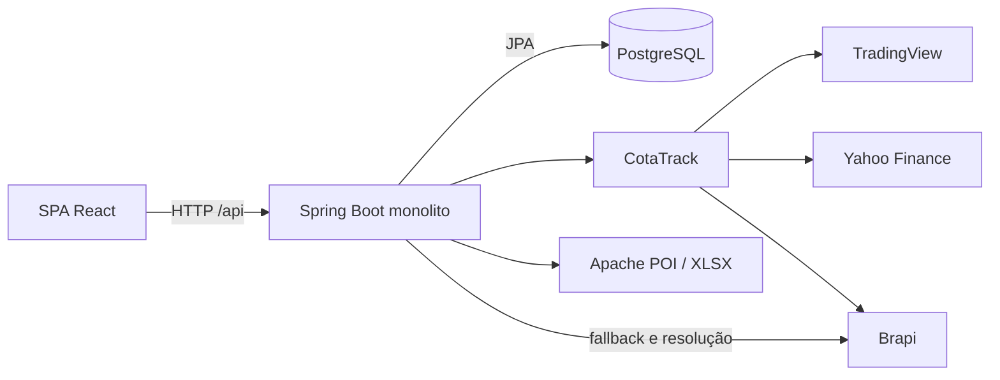

# Investize: auditoria de engenharia e ciclos incrementais de melhorias

Data: 27/10/2026. Cenário: até 100 usuários cadastrados e 10–15 simultâneos.

## Resumo executivo

A direção adequada é **uma SPA React, um monólito Spring Boot e PostgreSQL**.
Não há evidência de necessidade de serviços distribuídos. O principal risco atual
é a confiabilidade do dado financeiro e de seus fluxos de escrita, não capacidade
de CPU ou ausência de infraestrutura enterprise.

Este relatório reúne os entregáveis de arquitetura, produto, problemas,
performance, UI/UX, benchmark, segurança, observabilidade e roadmap.
Dois ciclos foram implementados nos dois repositórios, sem novas dependências.
A seção 12 consolida o segundo ciclo e o estado atual; os resultados históricos
da seção 10 permanecem identificados como primeiro ciclo.

A seção 13 inicia a rodada seguinte, exclusivamente com o diagnóstico dos fluxos
críticos. Nenhuma correção funcional dessa nova rodada foi implementada antes da
entrega do diagnóstico, conforme a ordem solicitada.

Resultados verificados no primeiro ciclo:

- Metas parciais continuam permitidas, por decisão explícita do usuário, mas
  soma de classes e soma de ativos em cada classe não podem superar 100%.
- Validações de lista agora devolvem HTTP 400 no contrato de erros da API,
  em vez de HTTP 500. Elementos nulos na lista de metas de ativos são rejeitados.
- Percentuais de resultado financeiro são arredondados somente no fim.
  Investimento `0.0000` não causa mais divisão por zero nos resumos.
- Páginas secundárias são carregadas sob demanda, mantendo a navegação visível.
  Falhas de carregamento/renderização possuem recuperação explícita.
- JS inicial completo: aproximadamente **490,58 → 408,69 kB**, ou
  **147,82 → 127,02 kB gzip: redução de 14,1% gzip**.
  Não confundir com a redução de 33,2% apenas do arquivo de entrada.
- Frontend: 49 testes unitários e 18 E2E aprovados; build/type-check e lint aprovados.
- Backend: suíte final com 69 testes descobertos, 68 aprovados e um ignorado
  preexistente, sem falhas. Oito casos parametrizados exercitam o contrato de metas.
  A validação final está consolidada na seção 10.

Segundo ciclo concluído: histórico completo em páginas de 25, privacidade de
preços, retry, correlação HTTP, eventos de acesso JSON e liveness autenticado.
Validação atual: **75 testes backend descobertos, 74 aprovados e um ignorado;
56 testes frontend; 18 E2E desktop/mobile; build/type-check e lint aprovados**.
Dez navegações de produção locais mediram FCP/LCP/CLS e heap da tela de login;
não equivalem a Lighthouse, dados reais de usuários ou capacidade sob concorrência.

### Alcance e limitações

Foram inspecionados os dois repositórios, seus manifests, rotas, camadas centrais,
persistência, migrations, integrações e jornadas. O profiling disponível foi
executado **antes das alterações funcionais**, começando por build, testes e browser.

Foram percorridas 16 rotas em desktop e mobile no modo demonstração. Os E2E
incluem uma jornada API com transporte interceptado, não um servidor real.
Não foram alterados dados da carteira real nem executadas cargas sobre o banco
existente. O preview de produção utilizado para medir scripts foi encerrado.

**Não estão concluídos:** pentest, inventário de CVEs, validação de permissões de
produção, profiling de CPU/heap da API real, p95 sob 15 usuários, planos de execução
PostgreSQL, auditoria WCAG completa e avaliação de todos os estados autenticados.
Os documentos abaixo diferenciam medição, defeito reproduzido e hipótese.
Adequação arquitetural não equivale a capacidade de produção certificada.

## 1. Relatório de arquitetura atual

### Frontend

- React 19 + TypeScript + Vite; React Router; Tailwind/CSS.
- TanStack Query para estado remoto; Zustand para preferências e edição mock.
- Recharts para gráficos; D3 hierarchy para mapa de calor; TanStack Virtual para listas.
- Divisão por `app`, `features`, `domain`, `services`, `state`, `shared` e `components`.
- Login/overview permanecem eager; demais páginas usam `React.lazy`.
- O shell fornece o workspace por contexto; não foi observado prop drilling que
  justifique outro gerenciador de estado.
- O adapter centraliza transporte, renovação de sessão e conversão DTO → domínio.

Evidências: [arquitetura frontend](../../investment-app-frontend/docs/FRONTEND-ARCHITECTURE.md),
[router](../../investment-app-frontend/src/app/AppRouter.tsx),
[adapter](../../investment-app-frontend/src/services/portfolioApi.ts),
[workspace](../../investment-app-frontend/src/features/portfolio/hooks/usePortfolioData.ts).

### Backend

- Java 21, Spring Boot 3.3.1, MVC/REST, Security/JWT, Validation, JPA/Hibernate.
- Camada HTTP em `infrastructure/web`; casos de uso em `application/service`;
  entidades e interfaces Spring Data em `domain`.
- DTOs de entrada/saída e um contrato central de erros.
- Serviços de movimentações, consolidação, metas, preço teto, sugestões,
  concentração, rebalanceamento, compartilhamento e importação XLSX.
- `BigDecimal` nas regras financeiras; fonte de verdade de produção no servidor.
- CotaTrack é uma dependência `1.0-SNAPSHOT`, complementada por Brapi e mecanismos
  locais de cache/circuit breaker/rate limiter.

### Banco

- PostgreSQL nos ambientes locais documentados; H2 compatível com PostgreSQL nos testes.
- Flyway V1–V10; Hibernate valida o schema.
- Relações principais:

```text
usuário -> carteiras -> movimentações
                  -> metas de classe -> metas de ativo
                  -> preferências/preço teto -> histórico de alterações
                  -> compartilhamentos
                  -> histórico de importação B3
catálogo de tickers -> classificação e metadados compartilhados
```

### Infraestrutura

- Compose local recomendado: PostgreSQL 17, volume próprio, healthcheck,
  bind em loopback, porta 5433; API local em 8086.
- Compose alternativo usa `postgres:latest`, porta 5432 e nome global de container:
  menor previsibilidade e mais possibilidade de conflito entre projetos.
- Frontend usa proxy de desenvolvimento `/api`; um deployment de produção precisa
  configurar esse encaminhamento no servidor de origem, não depender do proxy Vite.
- Workflow backend executa Maven em Java 23; release efetivo do projeto é 21.
- Nenhum desenho de produção/backup/restauração foi comprovado nesta auditoria.
- Cache existente é local ao processo; não se propõe Redis nem outro cache distribuído.

### Integrações e acoplamentos



- A camada de aplicação ainda conhece `BrapiClient`, tipos CotaTrack e JPA.
  Há portas `MarketQuoteProvider`/`MarketTickerProvider`, mas a inversão de
  dependências é parcial. Não reescrever tudo em arquitetura hexagonal.
- O cache remoto do frontend e as preferências locais têm fronteiras documentadas,
  mas os rascunhos de metas exigem cuidado ao trocar carteira e ao salvar.
- Leitura de resumo pode consultar fornecedores e salvar metadados de ticker:
  consulta, enriquecimento e persistência ficam acoplados.
- Algumas transações abrangem I/O externo; isso pode prolongar retenção de conexão.

### Pontos fortes

- Estrutura por features no frontend e responsabilidades reconhecíveis no backend.
- DTOs explícitos; controle por proprietário exercitado por testes de integração.
- Migrations versionadas, constraints e índices relevantes já presentes.
- Busca com debounce, listas virtualizadas e gráficos já separados por import dinâmico.
- Batch de cotações e de consulta de tickers já evita o N+1 mais óbvio por posição.
- Sugestões com orçamento, unidades inteiras, justificativas, teto e freshness.
- Compartilhamentos possuem testes de comportamento e de revogação/expiração.

### Riscos arquiteturais

1. Dado financeiro degradado pode parecer válido quando cotação vira zero.
2. Edição manual de posição usa duas requisições independentes, não uma operação atômica.
3. Dependência SNAPSHOT pode impedir reprodução de CI em máquina limpa.
4. H2 não valida locking, comportamento PostgreSQL nem planos de execução reais.
5. Backup/restauração, monitoramento e processo de deploy ainda precisam de evidência.

**Decisão:** manter o monólito e as ferramentas atuais. Sim, continua simples
para equipe pequena, 100 usuários e 10–15 simultâneos; não criar componentes
distribuídos para resolver problemas locais de consistência.

## 2. Produto e mapa de funcionalidades

### Problema e público

O Investize organiza posições e movimentações de investidores individuais,
mostra concentração e diferença para metas e auxilia a planejar aportes/vendas.
O público aparente é o investidor brasileiro que quer substituir planilhas,
entender sua distribuição e tomar decisões intencionais. Essa identificação
é inferida dos fluxos e textos; pesquisa com usuários ainda não foi realizada.

O sistema **registra movimentações e simula decisões**. Não integra execução
de ordens na corretora. Calcular aporte não registra operações, mas o diálogo
separado "Registrar compra" persiste um BUY no modo API. Confirmar vendas de
rebalanceamento persiste SELLs. A classificação anterior da confirmação de aporte
como meramente local estava incorreta para esse diálogo; a seção 13 distingue os
caminhos a partir do código atual.

### Jornadas

1. Cadastro/login → escolher/criar carteira → cadastrar/importar movimentações.
2. Overview → classe → ativo → compra/venda → revisão → registro.
3. Metas → elegibilidade/preço teto → simulação → entender alocação e saldo.
4. Concentração/mapa de calor → identificar exposição → rebalancear → revisar vendas.
5. Configurações → trocar/renomear/excluir carteira → logout.

### Mapa funcional

| Funcionalidade | Objetivo | Fluxo | Dependências | Riscos | Melhoria |
|---|---|---|---|---|---|
| Sessão e carteiras | Separar os dados de cada investidor | Login → seleção → workspace | JWT, API, usuário/carteira | Sessão expirada; recuperação de conta não avaliada | Validar expiração, reentrada e recuperação |
| Visão geral | Entender patrimônio e resultado | Resumo → filtros/ordenação → ativo | Consolidação, cotações, metas | Zero pode significar falta de cotação | Estado explícito de dado indisponível |
| Compra/venda | Manter posição correta | Ativo → valores → revisão → confirmar | Catálogo, validação, movimentos | Concorrência e duplo envio precisam teste dedicado | Proteção contra duplicação e testes de concorrência |
| Histórico | Auditar operações | Listagem de movimentos | API paginada | Antes: UI só pedia página 0 de 100 itens | Segundo ciclo: páginas de 25, ordenação estável, retry e privacidade |
| Importação XLSX | Migrar planilhas/B3 | Origem → arquivo → processamento → resultado | POI, parsers, fornecedores, banco | Snapshot substitutivo; idempotência e falha parcial | Prévia, contagens corretas e confirmação destrutiva |
| Metas | Expressar distribuição desejada | Classes → ativos → salvar | Allocations, workspace | Soma acima de 100%; divergência entre camadas | Corrigido neste ciclo; parcial não é normalizado |
| Preço teto/elegibilidade | Restringir candidatos | Editar valor/habilitar → autosave | Preferências, auditoria, API | Múltiplas gravações concorrentes; falta de feedback | Estado salvando/salvo/falhou por operação |
| Sugestão de aporte | Distribuir valor com regras explicáveis | Informar orçamento → calcular → revisar | Metas, teto, quotes frescas, motor | Dado faltante; expectativas de ordem real | Mostrar origem/idade da cotação de forma consistente |
| Rebalanceamento | Comparar exposição e planejar vendas | Modo → plano → revisão → registro | Cálculo servidor e movimentos | Registro de várias vendas não é atomicidade global | Explicitar resultado parcial e impedir reenvio indevido |
| Concentração e heatmap | Entender risco e variação | Agrupar → inspecionar → ativo | Holdings, cotações, classificação | Indicador heurístico não equivale a análise profissional | Explicação dos limites e alternativa textual |
| Compartilhamento | Permitir leitura consentida | Criar → consumir snapshot → revogar | API pública e token de compartilhamento | Superfície pública exige revisão dedicada | Backend existe; jornada equivalente não está no router SPA |
| Configurações | Privacidade e gestão de carteira | Ocultar valores/trocar/renomear/excluir | Preferências locais e API | Exclusão irreversível e estados antigos | Confirmação contextual e testes de dados associados |

Funcionalidades principais: carteira, movimentos, importação, metas e aporte.
Secundárias: visualizações avançadas, exportação Markdown, compartilhamento e
personalizações. Não priorizar novas análises sofisticadas antes de confiança no dado.

## 3. Relatório de problemas técnicos

Legenda: **confirmado** = leitura direta ou teste reproduzível;
**hipótese** = precisa de medição/ensaio adicional. P0 = próximo ciclo antes de
confiar no fluxo afetado; P1 = alta prioridade; P2 = melhoria; P3 = oportunidade.

| ID | Problema e evidência | Impacto | Esforço | Ganho esperado | Prioridade / estado |
|---|---|---|---|---|---|
| T01 | Resumos dividiam e arredondavam antes de multiplicar por 100 | Ex.: 12,50% virava 13%; perda de precisão na apresentação financeira | Baixo | Erro máximo de arredondamento cai para 0,005 p.p. na regra de duas casas | P1 / corrigido |
| T02 | `BigDecimal.equals(ZERO)` falhava para `0.0000` | Divisão por zero, indisponibilidade do resumo | Baixo | Fluxo de custo zero deixa de gerar erro aritmético | P1 / corrigido |
| T03 | Metas validavam campos, não a soma | Distribuição impossível acima de 100% | Baixo/médio | Regra única coerente no browser e API | P1 / corrigido |
| T04 | Handler genérico convertia `HandlerMethodValidationException` em 500 | Cliente não consegue distinguir entrada inválida de defeito servidor | Baixo | Contrato 400 + código `VALIDATION_FAILED`; retorno inválido continua 500 | P1 / corrigido |
| T05 | Páginas não utilizadas integravam o JS inicial | Mais download e parse na entrada | Baixo | Menos 14,1% gzip no conjunto inicial medido | P2 / corrigido |
| T06 | Dois testes de integração registravam ticker via provedor real | Rede/certificado interferiam na suíte; alertas PKIX no baseline | Baixo | Dois fluxos passam a usar provider mockado | P1 / corrigido |
| T07 | Editar posição faz SELL e depois BUY em duas chamadas | Se BUY falhar, SELL permanece; alteração sintética de histórico | Médio | Uma operação servidor com semântica de correção definida | P0 / pendente |
| T08 | Quote ausente pode ser transformada em preço zero no resumo | Patrimônio/resultado enganoso, embora cálculo de sugestões seja mais estrito | Médio | Diferenciar indisponível de preço real e evitar falso −100% | P1 / pendente |
| T09 | Histórico buscava somente primeira página de 100 | Operações antigas ficavam inacessíveis na UI | Baixo/médio | Histórico integral acessível sem carregar tudo | P1 / corrigido no segundo ciclo |
| T10 | Importação apresenta sucesso genérico e chama movimentações de ativos | Contagens e falhas parciais podem confundir o usuário | Baixo | Resultado alinhado a status/negociações/duplicadas | P1 / pendente |
| T11 | `AssetSummaryService` concentra batch, fallback, descoberta, escrita e DTO | Acoplamento e custo de testes/manutenção | Médio | Separar apenas enriquecimento e política de indisponibilidade | P2 / pendente |
| T12 | `PortfolioPages` e `ContributionPages` agrupam várias jornadas; JSX denso | Mudanças cruzadas mais arriscadas; chunks por módulo, não por tela | Médio | Extrair quando houver mudança concreta; não fragmentar tudo agora | P2 / pendente |
| T13 | Categoria → coleção lazy de allocations | Possível N+1 limitado ao número de classes | Baixo após medir | Contagem de SQL estável, se demonstrar custo | P2 / hipótese de custo |
| T14 | Summary/concentration/classes podem reconsolidar mesma carteira | Trabalho e I/O repetidos por navegação | Médio | Reusar resultado por requisição onde aplicável | P2 / medir antes |
| T15 | Dependência CotaTrack SNAPSHOT sem resolução remota comprovada | Build local pode passar e CI limpa falhar | Médio | Build reproduzível com versão publicada/imóvel | P1 / pendente |
| T16 | Falha de importação salva histórico e lança erro na mesma transação | Histórico de falha pode sofrer rollback junto com operação | Médio | Teste de rollback e política de histórico explícita | P1 / hipótese a validar |
| T17 | README dizia Java 23 obrigatório e apenas três categorias | Onboarding errado apesar do código suportar Java 21 e sete categorias | Baixo | Documentação coerente com manifests e adapter | P2 / corrigido |
| T18 | Plano PostgreSQL/capacidade/backup sem ensaio | Falhas operacionais só aparecem no uso real | Médio | Recuperação testada e orçamento de latência conhecido | P1 / pendente |

Evidências centrais:
[resumo de ativo](../src/main/java/dev/jaoow/investmentapp/application/service/summary/AssetSummaryService.java),
[resumo da carteira](../src/main/java/dev/jaoow/investmentapp/application/service/summary/PortfolioSummaryService.java),
[metas servidor](../src/main/java/dev/jaoow/investmentapp/application/service/AllocationService.java),
[handler](../src/main/java/dev/jaoow/investmentapp/infrastructure/web/GlobalExceptionHandler.java),
[edição da posição](../../investment-app-frontend/src/features/portfolio/pages/PortfolioPages.tsx),
[histórico UI](../../investment-app-frontend/src/features/portfolio/pages/MovementsPage.tsx),
[importação B3](../src/main/java/dev/jaoow/investmentapp/application/service/b3/B3NegotiationImportService.java).

### SOLID, DRY, KISS, estado e renderizações

- Há serviços focados e interfaces para mercado; a maior oportunidade SOLID está
  no resumo/enriquecimento, não em uma reestruturação global de pacotes.
- A fórmula financeira duplicada foi extraída para um helper pequeno e restrito
  ao pacote de resumos; não foi criada uma biblioteca financeira.
- TanStack Query já é o dono do estado remoto. Não adicionar Redux ou espelhar
  respostas em Zustand. Rascunhos e preferências não devem tornar-se cache paralelo.
- Não há evidência de re-render excessivo que justifique espalhar `memo`/`useMemo`.
  Filtros e somas sobre uma carteira pequena são aceitáveis. Medir com React Profiler
  antes de otimizar esses loops.
- A lista já é virtualizada; o gráfico agrega muitos segmentos. Manter esses
  mecanismos existentes, sem expandir virtualização para formulários pequenos.
- Testes financeiros devem usar valores exatos; comparar apenas se “a tela abriu”
  ou se o teste terminou não detecta erros de percentuais.

## 4. Banco: modelagem, consultas e custos

Os custos abaixo são **estruturais**, não tempos/EXPLAIN medidos.
Não foi alegada a existência de consulta lenta ou full scan real sem plano PostgreSQL.

| Consulta/fluxo | Custo provável | Problema/rastreamento | Sugestão | Impacto |
|---|---|---|---|---|
| Movimentos por carteira/ticker | Proporcional ao histórico selecionado | Índice `(portfolio_id,ticker_symbol)` já existe na V2 | Preservar; medir volume representativo | Evita índice redundante |
| Consolidação da carteira | O(M log M), ordenação de M movimentos em memória | Reprocessada para resumo e outros analytics | Medir com 1k/10k movimentos antes de materializar saldo | Para 100 usuários, processamento local tende a ser suficiente |
| Metas por carteira + ativos | Potencial uma consulta por coleção lazy | `findByPortfolioId` e acesso a `getAssetAllocations` | Contar SQL; se necessário `EntityGraph`/fetch join direcionado | Evitar N+1 sem tornar tudo EAGER |
| Catálogo por holdings | Consulta batch por IDs | `findAllById` já utilizado | Manter batch | Não adicionar consultas por ticker |
| Busca de ticker | `LOWER(symbol) LIKE '%termo%'` não favorece B-tree comum | Full scan é possível e aceitável em catálogo pequeno | Medir antes de índice especializado; não adicionar extensão agora | Menos custo de manutenção |
| Setores/subsetores | Uma busca de subsetor por setor | N+1 explícito no método de catálogo | Consulta única/projeção se esse endpoint demonstrar uso/custo | Otimização local, sem cache distribuído |
| Histórico de teto | Filtro carteira/ticker e ordem temporal | Índice inclui carteira, ticker, data e ID na V4 | Preservar paginação e desempate por ID | Consulta já alinhada ao acesso |
| Histórico de movimentos | Antes: endpoint paginado; frontend fixava `page=0&size=100` | Problema de UX, não ausência de paginação no banco | Implementado: páginas de 25, data + ID decrescentes | 105 registros percorridos via HTTP/JPA; ver seção 12 |
| Histórico B3 atual | V9 recria tabela sem os índices da estrutura V8 removida | Não supor que os índices antigos ainda existam | EXPLAIN em dados representativos; avaliar `(portfolio_id, imported_at, id)` | Evita criar índice sem uso comprovado |
| Deduplicação B3 | Busca por carteira e hashes; coluna external reference é globalmente UNIQUE | Validar semântica entre carteiras e importações concorrentes | Testes de duas carteiras e de repetição concorrente | Confiabilidade antes de velocidade |
| Troca de metas | Exclusão + flush + inserção em transação | Rejeição deve preceder exclusão | Já preservado e testado neste ciclo | Requisição inválida não apaga metas anteriores |

Relacionamentos e migrations estão em
[entidades](../src/main/java/dev/jaoow/investmentapp/domain/entity) e
[migrations](../src/main/resources/db/migration).

Não foram adicionados índices, novas tabelas ou migrações neste ciclo.
Próximo ensaio: PostgreSQL isolado, dados sintéticos e `EXPLAIN (ANALYZE, BUFFERS)`
apenas sobre consultas de leitura seguras. Planejar separadamente queries mutáveis,
locking, restauração e permissões.

## 5. Relatório de performance

### Baseline anterior à implementação

| Medida | Antes | Depois | Interpretação |
|---|---:|---:|---|
| Entry JS | 490,58 kB / 147,82 gzip | 327,50 kB / 100,19 gzip | Não representa sozinho todos os scripts iniciais |
| JS inicial, incluindo preloads | 490,58 kB / 147,82 gzip | 408,693 kB / 127,024 gzip | −16,7% bruto; **−14,1% gzip** |
| Chunk gráfico | 316,35 kB / 93,32 gzip | 316,38 kB / 93,33 gzip | Continua lazy; praticamente inalterado |
| CSS | 67,98 kB / 14,62 gzip | 68,00 kB / 14,63 gzip | Sem melhoria relevante |
| Total de JS gerado | ~822,96 kB | 831,273 kB | ~1% maior; benefício é adiar trabalho, não eliminar funcionalidades |
| Quantidade de chunks JS | 3 | 23 | Trade-off de granularidade e requisições; sem política manual de chunks |
| Build Vite, uma execução | 1,17 s | 1,13 s final | Variação pequena; não alegar ganho de build |
| Vitest | 45 aprovados | 49 aprovados | Cobertura funcional, não benchmark |
| E2E | 14/18 aprovados | 18/18 aprovados | Regressões antigas de contrato de metas resolvidas |
| Maven offline, suíte | 47,829 s; 56 descobertos, 1 ignorado | 25,715 s; 69 descobertos, 1 ignorado | Sem comparação causal: aquecimento e contextos diferem |

O cálculo de gzip usou compressão local dos artefatos; servidor de produção deve
habilitar compressão para materializar a economia de rede.

### Confirmação no browser de produção

Preview Vite temporário em loopback, Chromium com contexto novo, rota `/login`,
fontes externas bloqueadas apenas no ensaio para reduzir variação. Scripts recebidos:

```text
index-22PvL-Dk.js          327500 bytes
clsx-BbohabLV.js            9267 bytes
PageHeading-2xo1qrvz.js    71926 bytes
total                    408693 bytes
```

Nenhum chunk de página secundária nem Recharts foi carregado nessa entrada.
`DOMContentLoaded` foi 79 ms em uma execução local. **Não há baseline equivalente
anterior de produção**, portanto não se afirma redução de latência, LCP ou INP.
Os nomes dos arquivos são hashes deste build, não interfaces estáveis.

### Browser de desenvolvimento e responsividade

16 rotas × duas larguras: 32 verificações de heading/estado e largura documental.
Desktop 1280 px; mobile solicitado 393 px, largura efetiva reportada ~394 px.
Não foi detectado overflow horizontal global nesses estados.
`DOMContentLoaded` variou aproximadamente 267–378 ms no Vite aquecido.
Esses números não são tempos de negócio, não incluem conclusão de todas as queries,
e não são comparáveis ao preview de produção nem a uma conexão móvel real.

### Classificação

| Nível | Item | Evidência / decisão |
|---|---|---|
| Crítico | Nenhum gargalo de capacidade comprovado | Não inventar p95, uso de CPU ou limites do banco |
| Alto, risco | Fornecedores/fallback em transações de resumo | Caminho confirmado em código; latência ainda não medida |
| Médio | JS inicial e código de rotas desnecessário na entrada | Medido e melhorado; avaliar navegação em rede lenta no próximo ciclo |
| Médio, risco | Repetição de consolidação/queries de metas | Medir SQL/endpoint antes de alterar fetch/caching |
| Baixo | Micro-otimização de filtros e somas React | Sem React Profiler que a justifique |
| Baixo | Assets ilustrativos e tree shaking | Build funciona; nenhuma redução de imagens foi creditada |

### Próximo protocolo de profiling, sem instalar uma plataforma

1. API e PostgreSQL isolados; dados fictícios com carteiras pequenas e 1k/10k movimentos.
2. Medir endpoints overview, movimentos, metas, simulação e concentração com
   1, 5 e 15 usuários virtuais; separar cache frio/quente e falha de fornecedor.
3. Registrar p50/p95, erros, quantidade de SQL, conexão ocupada e tempo externo.
4. JFR curto para CPU/alocação/GC, sem gravação de payload financeiro.
5. `EXPLAIN` das consultas dominantes; React Profiler e Web Vitals em build de produção.
6. Orçamento inicial proposto, não resultado: p95 <500 ms em leitura local sem
   fornecedor; documentar orçamento separado de mercado externo e timeout total;
   LCP <2,5 s e INP <200 ms em dispositivo/rede definidos.
7. Só otimizar gargalos encontrados; não criar cache distribuído, filas ou
   projeções persistentes preventivamente.

## 6. Relatório de UI/UX

### Método

Inspeção de rotas, código, árvore acessível, screenshot do heatmap e E2E desktop/mobile.
Todos os mockups abaixo são **conceituais em texto**, não layouts finais.
Testes de contraste, leitor de tela e estados de produção continuam pendentes.
Recomendações visuais não são alegações de falha WCAG comprovada.

| Tela | Problema/risco observado | Impacto | Sugestão | Mockup conceitual | Prioridade |
|---|---|---|---|---|---|
| Login/cadastro/seleção | Navegação existente; recuperação de conta não evidenciada nos fluxos avaliados | Bloqueio de retorno pode exigir suporte | Projetar recuperação após definir política de conta | `Entrar → erro junto ao campo → recuperar acesso` | P2 |
| Overview | Resultado rotulado como período pode ser confundido com performance total histórica | Interpretação financeira errada | Explicar custo atual, valorização não realizada e origem da cotação | `Patrimônio · atualizado em… / Resultado das posições abertas (?)` | P1 |
| Carteira | Várias ações competem no cabeçalho | Mais esforço de escolha, especialmente mobile | Manter movimentação principal e agrupar secundárias se teste de uso confirmar | `[Nova movimentação] [Mais: importar, copiar, análises]` | P2 |
| Detalhe de classe | Metas e valores têm boa hierarquia, mas dependem de várias leituras | Pode exibir divergência entre resumo e detalhe | Sinalizar atualização/erro parcial e manter retorno para carteira | `Classe / Atual → Meta / Ativos / Atualizando…` | P2 |
| Detalhe de ativo | Edição substitui posição via SELL + BUY separados; texto de demonstração aparece no JSX independentemente do modo | Risco de escrita parcial e comunicação inadequada no modo API | Priorizar correção atômica e texto por origem real/mock | `Ativo / Dados de… / Corrigir posição → revisão explícita` | P0 |
| Nova movimentação | Wizard tem revisão e feedback; busca de ticker usa catch amplo em caminho de cadastro | Erro de infraestrutura pode parecer ticker inexistente | Distinguir 404 de falha de consulta e permitir nova tentativa | `Buscar → indisponível [Tentar] / sem resultado [Cadastrar]` | P1 |
| Movimentações | Antes: apenas 100 registros; sem próximas páginas | Histórico incompleto | Implementado: total, páginas, retry, loading e preços ocultáveis | `1–25 de 142 / [Anterior] [Próxima]` | P1, corrigido no segundo ciclo |
| Importação | Snapshot destrutivo tem aviso, mas falta revisão/consentimento específico; resultado sempre genérico | Perda acidental de histórico e falsa compreensão do resultado | Prévia + confirmação de substituição + status real | `Validar → 120 novas / 8 duplicadas / revisar → importar` | P1 |
| Concentração | Limites são heurísticos e podem parecer recomendação universal | Excesso de confiança | Explicar limites de alerta e dados não classificados | `Exposição / Limites usados (?) / setores não informados` | P2 |
| Mapa de calor | Cor + área concentram informação; blocos pequenos e touch requerem avaliação | Leitura difícil e possível dependência da visão | Manter números/sinais e oferecer tabela equivalente; validar teclado | `[Mapa] [Lista] / ticker, peso, variação, horário` | P2 |
| Metas | Permitida soma acima de 100%; erro não explicava a soma | Salvamento inválido | Corrigido: soma validada e erro contextual; parciais mantidas | `95% definido / até 100% / [Salvar]` | P1, parte corrigida |
| Aportes (menu) | Cards explicam os fluxos e há disclaimer | Bom reconhecimento, mas status de configuração fica distante | Acrescentar resumo somente se reduzir dúvidas reais | `Metas ✓ / tetos pendentes 2 / Simular` | P3 |
| Elegibilidade/tetos | Autosave tem erro global, sem estado individual de progresso | Usuário não sabe se pode sair ou se alteração persistiu | Feedback salvando/salvo/falhou junto à linha | `PETR4 [teto] · Salvando… → Salvo / Tentar novamente` | P1 |
| Simulador | Explicações e saldo existem; separar simulação de operação continua essencial | Usuário pode interpretar confirmação como ordem | Exibir data/fonte e próxima ação sem prometer compra | `Simulação / fonte+horário / sobra / registrar manualmente` | P1 |
| Rebalanceamento | Confirmação registra vendas; lote pode ser parcialmente salvo, e código já informa quais foram registradas | Repetição manual pode duplicar operação | Evidenciar registrados/pendentes e testar interrupção/reenvio | `3 registradas / 1 pendente / revisar somente pendente` | P1 |
| Configurações | Exclusão usa `window.confirm`; troca e rename têm feedback textual | Confirmação pouco contextual; foco/feedback merecem revisão | Dialog com nome e consequência, sem mudar a semântica agora | `Excluir “Principal”? / dados afetados / Cancelar / Excluir` | P2 |

### Nielsen e acessibilidade transversal

- **Visibilidade:** estados loading/erro existem. Agora o loading tem `role=status`
  e falhas de chunks têm mensagem e ação, em vez de tela quebrada.
- **Controle:** shell e menu permanecem utilizáveis durante carregamento/falha da rota.
  A fronteira de erro reseta na troca de pathname.
- **Consistência:** componentes locais e tokens escuros já dão identidade comum.
  JSX extenso com estilos inline merece extração apenas quando a tela for revisada.
- **Prevenção:** soma financeira validada antes do envio e no servidor; próximo
  foco é confirmação de importação/edição destrutiva.
- **Feedback:** não tratar todo erro de API como vazio ou ausência do ativo.
- **Teclado:** dialogs possuem nomes/aria-modal, mas foco preso, Escape e retorno
  de foco não estão implementados em todos os dialogs lidos; testar antes de padronizar.
- **Contraste:** tons cinza e tamanhos pequenos devem ter medição WCAG, não um
  redesign baseado apenas em impressão de screenshot.
- **Responsividade:** estados inspecionados sem overflow global; não prova adequação
  de zoom 200%, traduções, mensagens longas ou todos os conteúdos reais.

## 7. Benchmark e oportunidades

Consulta a páginas públicas oficiais em 27/10/2026. Não se copiou interface,
conteúdo proprietário nem funcionalidade por imitação.

| Referência | Evidência pública consultada | Adaptação adequada ao Investize |
|---|---|---|
| [Investidor10](https://investidor10.com.br/) | Gerenciador consolidado, conexão B3 anunciada, proventos e indicadores, além de ferramentas fiscais | Melhorar importação e explicação da origem dos dados; proventos depois de garantir posições corretas |
| [Status Invest](https://statusinvest.com.br/) | Separação por ações/FIIs/BDRs/stocks e calendários de eventos/proventos | Clareza de categorias e, futuramente, agenda contextual; não transformar o app em portal de mercado |
| [Sharesight](https://www.sharesight.com/) | Consolidação, integração com corretoras, dividendos e planos com limites explícitos | Onboarding com primeira carteira, transparência de cobertura e limites; não prometer “rentabilidade real” sem eventos/fluxos |

O site Kinvo foi consultado, mas o conteúdo retornado não forneceu evidência
comparável de produto. Foi excluído da comparação, em vez de presumir capacidades.
O endereço específico `/carteira/` do Investidor10 retornou 404; utilizou-se sua home.
Preços comerciais não foram usados para decisões de engenharia.

Oportunidades:

1. **Agora:** onboarding de carteira confiável, prévia de importação, estado de
   atualização de cotação e distinção entre simulação, registro e ordem.
2. **Médio prazo:** proventos/eventos corporativos, reconciliação e performance
   explicitamente definida. Levantar demanda com os primeiros usuários.
3. **Futuro:** benchmark CDI/índices, integrações automáticas e compartilhamento
   completo no frontend, somente com custo/dados/licenças/consentimento esclarecidos.

Não priorizar fiscal completo, automação com corretoras ou análises sofisticadas
apenas porque concorrentes maiores oferecem essas funções.

## 8. Relatório de segurança

**Status: revisão incompleta/inconclusiva.** Não há vulnerabilidade explorável
validada para apresentar nesta entrega. Isso **não** significa que o sistema
esteja seguro ou que todos os fluxos tenham sido cobertos.
Não foi realizado pentest ou teste adversarial em dados/serviços de terceiros.

| # | Severity | File | Lines | Vulnerability | Confidence |
|---|----------|------|-------|---------------|------------|
| — | — | — | — | Nenhuma vulnerabilidade validada; cobertura de segurança insuficiente para conclusão | — |

### Evidências limitadas disponíveis

- Testes de integração exercitam proprietário versus outro usuário em carteiras,
  configurações e histórico de teto; não substituem matriz de todos os endpoints.
- Há contrato central de erros e DTOs de validação. Nesta entrega, testes
  demonstraram e corrigiram uma resposta 500 indevida para entrada inválida.
  Esse defeito de confiabilidade não foi promovido a vulnerabilidade sem exploração.
- O adapter persiste tokens no armazenamento do browser. Isso amplia o impacto
  potencial de um XSS, mas armazenamento local sozinho não comprova XSS.
- Scripts/documentação orientam segredo no backend. Não há atestado de ausência
  de secrets em todo o histórico ou nos bundles/deployments existentes.

### Riscos a verificar, não achados confirmados

| Área | Risco a investigar | Impacto potencial | Verificação/correção condicionada | Prioridade |
|---|---|---|---|---|
| Autorização | Cobertura de ownership em todos os GET/POST/PUT/DELETE e imports | Leitura/alteração de carteira alheia | Matriz usuário A/B, ID inexistente e endpoints públicos | P1 |
| Sessão | Refresh, revogação, expiração, logout e distinção de tipos de token | Uso indevido de sessão | Testes adversariais isolados; não migrar para cookies sem avaliar CSRF/CORS | P1 |
| Browser | XSS + acesso a tokens persistidos | Sequestro de sessão | Revisar sinks/URLs, política CSP e sanitização conforme uso real | P1 |
| Upload | Arquivos excessivos, ZIP/XLSX hostil, headers e células inesperadas | Exaustão de memória/CPU ou inconsistência | Ensaios de limites com arquivos sintéticos e rollback | P1 |
| Banco | Usuário de runtime com privilégios indevidos; ausência de backup restaurável | Exposição/perda de dados | Revisar grants e restauração em ambiente autorizado | P1 |
| Dependências | Versões sem inventário de vulnerabilidades e SNAPSHOT | Vulnerabilidade ou build não reproduzível | Scanner na CI com metadados autorizados e triagem de reachability | P1 |
| Compartilhamento | Validade, revogação, disclosure e comportamento sem valores | Exposição não consentida | Testar snapshots e token expirado/revogado sem dados reais | P1 |
| Logs | Possível presença de tokens, payloads, e-mails ou mensagens de fornecedor | Dados pessoais/sensíveis em logs | Revisar emissão/retenção; testar redaction; não logar corpos/Authorization | P1 |
| Infra | Configurações locais reutilizadas em ambiente compartilhado | Exposição de serviço ou credenciais de desenvolvimento | Configuração própria de produção, TLS e rede controlada | P1 |

Nenhuma mudança de autenticação, permissão, política de banco ou segredo foi
feita sob suposição. Uma revisão de segurança completa continua sendo gate
para uma declaração de prontidão de produção.

## 9. Observabilidade mínima viável

### Existente e comprovado em código

- SLF4J com logs de exceção no handler global.
- Logs de batch de cotação com quantidade solicitada/resolvida, fornecedor,
  cache e duração (`durationMs`).
- Erros padronizados com timestamp/status/code/details.
- Histórico de alterações de preço teto e importações.
- A nova fronteira React registra falha no console e apresenta recuperação ao usuário.
- Segundo ciclo: filtro HTTP com UUID validado em `X-Correlation-ID`, MDC e
  duração monotônica; um evento JSON por requisição síncrona com rota normalizada.
- Logs regulares de aplicação/erro incluem o ID de correlação no formato textual.
- Liveness autenticado `GET /v1/health`, sem consultar banco ou fornecedor.

### Não comprovado

Métricas HTTP agregadas, error tracking centralizado, correlação ponta a ponta,
dashboards, alertas, tracing distribuído e retenção/redaction operacional.
Console do browser não equivale a error tracking.

### Proposta mínima e situação após o segundo ciclo

1. Um identificador de requisição gerado no servidor, devolvido em header e logs;
   aceitar IDs externos apenas com validação de tamanho/formato.
2. Log de acesso com método, rota normalizada, status e duração. Sem corpos,
   tokens, parâmetros financeiros ou e-mail. Evitar cardinalidade por carteira/ticker.
3. Medir p95/5xx e duração de fornecedor. Começar com logs agregados e monitor
   externo simples de disponibilidade; não instalar um cluster de observabilidade.
4. Alertar indisponibilidade contínua e falhas de backup; definir retenção curta
   compatível com necessidades operacionais/privacidade.
5. Se o time não conseguir acompanhar erros do browser, avaliar um único error
   tracker com redaction e aprovação de envio de dados. Nenhum SaaS foi configurado.
6. Healthcheck mínimo deve distinguir processo saudável de cotação indisponível.
   Não expor métricas administrativas publicamente.

Itens 1, 2 e liveness do item 6 implementados; p95 agregado, readiness de banco,
retenção e alertas continuam pendentes de ambiente e operação. A correlação fica
no processo MVC síncrono; não se afirma correlação completa no browser, em jobs
ou em chamadas externas. Detalhes e testes na seção 12.

Para a escala prevista, não há justificativa para tracing distribuído,
OpenTelemetry Collector, Kafka, Elasticsearch ou plataforma enterprise agora.

## 10. Execução: causa, código, ganho, risco e validação

### Ciclo A — metas e contrato HTTP

**Problema:** totais acima de 100% eram aceitos; docs e E2E antigos exigiam
exatamente 100%. O usuário definiu: parciais são permitidas, nunca acima de 100%.

**Causa:** validação individual sem invariantes de soma; generic catch do handler
interceptava a exceção de validação de métodos do Spring MVC e respondia 500.

**Solução/código:** totais verificados antes de apagar metas existentes;
erro de soma contextual no browser, API independente e erros de entrada como 400.
Elementos nulos de assets são rejeitados por Bean Validation.

```typescript
export function isAllocationValid(values: number[]) {
  return values.every((value) => Number.isFinite(value) && value >= 0 && value <= 100)
    && totalPercentage(values) <= 100 + Number.EPSILON * 100 * values.length
}
```

A tolerância é somente para ruído de ponto flutuante, não uma margem de 0,01 p.p.
O servidor calcula com BigDecimal e limite exato.

Arquivos:
[helper e testes frontend](../../investment-app-frontend/src/features/goals/allocation.ts),
[tela](../../investment-app-frontend/src/features/goals/pages/GoalsPage.tsx),
[serviço](../src/main/java/dev/jaoow/investmentapp/application/service/AllocationService.java),
[DTO](../src/main/java/dev/jaoow/investmentapp/application/dto/request/CategoryAllocationRequest.java),
[handler](../src/main/java/dev/jaoow/investmentapp/infrastructure/web/GlobalExceptionHandler.java),
[integração POST/PUT](../src/test/java/dev/jaoow/investmentapp/AllocationValidationIntegrationTests.java).

**Ganho:** invariantes verificadas em duas camadas, rejeição de 100,01%, ausência
de remoção de metas em substituição inválida e erros distinguíveis pelo cliente.
**Risco:** carteiras que já possuam totais inválidos precisam correção manual;
nenhuma migração de dados foi executada. O percentual não definido não é redistribuído
e não equivale a uma posição real de caixa.

**Validação:** testes parciais/exatos/zero, soma de categorias, soma de ativos
inclusive categoria zero, negativos, nulos, coleções vazias e preservação de metas.
E2E verifica soma de 105%, parcial de 95% e total inválido por ativo.
Erros de validação de retorno do servidor continuam tratados como defeito 500.

### Ciclo B — carregamento de páginas e recuperação

**Problema/causa:** imports estáticos de páginas secundárias no router faziam
todo esse código participar da carga inicial.

**Solução:** `React.lazy` por módulo existente; Suspense e boundary em torno
do outlet, mantendo shell/menu. Não criar política manual de vendors.

```tsx
const GoalsPage = lazy(() => import('../features/goals/pages/GoalsPage')
  .then((module) => ({ default: module.GoalsPage })))
```

Arquivos:
[router](../../investment-app-frontend/src/app/AppRouter.tsx),
[fronteira de rota](../../investment-app-frontend/src/app/RouteContent.tsx),
[testes de pending/rejection](../../investment-app-frontend/src/app/RouteContent.test.tsx),
[loading acessível](../../investment-app-frontend/src/shared/components/LoadingState.tsx).

**Ganho:** −14,1% gzip inicial completo medido. **Risco:** mais chunks e um round
trip na primeira entrada em cada módulo. O total de JS aumenta aproximadamente 1%.
O deploy deve preservar assets antigos durante transição e servir HTML com política
de cache apropriada; em falha, recarregar ou navegar está disponível.
O agrupamento de telas do mesmo módulo evita uma refatoração desnecessária.

**Validação:** build/lint/type-check; testes de loading, falha e navegação;
18 E2E; confirmação dos três scripts realmente recebidos no preview.

### Ciclo C — precisão e confiabilidade dos resumos financeiros

**Problema:** `25 / 200`, arredondado primeiro, produzia 13% em vez de 12,50%.
`0.0000.equals(BigDecimal.ZERO)` é falso, permitindo divisão por zero.

**Solução:** regra pequena compartilhada por resumo de ativo e carteira.

```java
static BigDecimal percentageChange(BigDecimal investedAmount, BigDecimal profitOrLoss) {
    return investedAmount.signum() == 0 ? BigDecimal.ZERO
            : profitOrLoss.multiply(BigDecimal.valueOf(100))
                    .divide(investedAmount, 2, RoundingMode.HALF_UP);
}
```

Arquivos:
[SummaryMath](../src/main/java/dev/jaoow/investmentapp/application/service/summary/SummaryMath.java),
[testes carteira](../src/test/java/dev/jaoow/investmentapp/application/service/summary/PortfolioSummaryServiceTests.java),
[testes ativo](../src/test/java/dev/jaoow/investmentapp/application/service/summary/AssetSummaryServiceTests.java).

**Ganho:** erro de arredondamento final limitado a 0,005 p.p.; no caso 12,5%,
correção de 0,5 p.p. O valor financeiro absoluto não é alterado por essa fórmula.
**Risco:** números exibidos podem mudar e snapshots precisam refletir a precisão
correta. Retorno sobre custo zero continua zero por convenção existente, não
representa retorno financeiro matematicamente definido ou performance TWR/IRR.

**Validação:** antes da correção, quatro assertions de precisão falharam e dois
casos geraram divisão por zero. Depois, casos positivos, negativos e zero com
escala passam nas duas superfícies. Também foi verificado custo zero sem quotes.

### Ciclo D — testes herméticos e documentação

**Problema/causa:** testes de registro de ticker acessavam provider real para
enriquecimento; baseline tinha avisos PKIX. README não refletia Java/categorias/metas.

**Solução:** mock da interface já existente em duas classes de integração,
mantendo todo o fluxo HTTP/JPA real sob teste. Docs alinhadas às regras efetivas.

Arquivos:
[teste de movimentos](../src/test/java/dev/jaoow/investmentapp/AssetMovementValidationIntegrationTests.java),
[teste de configurações](../src/test/java/dev/jaoow/investmentapp/AssetSettingsIntegrationTests.java),
[README API](../README.md),
[README SPA](../../investment-app-frontend/README.md).

**Ganho:** esses testes deixam de depender da rede/certificados de fornecedor.
**Risco:** não validam a integração real de mercado, que precisa de teste contratado
separado; não atribuir toda redução de duração da suíte ao mock.
**Validação:** suíte completa aprovada; os avisos PKIX desses fluxos desapareceram.
Warnings de instrumentação Mockito e compatibilidade Flyway/H2 continuam conhecidos.

### Comandos e resultado final

Frontend:

```powershell
npm run build
npm run lint
npm run test
npm run test:e2e
```

Backend:

```powershell
.\mvnw.cmd test
```

O comando Maven padrão desta máquina falhou por HTTP 403 no mirror configurado.
A alternativa que funcionou foi execução **offline**, com settings temporários
vazios para usuário/global, usando os artefatos já disponíveis no repositório
local. Nenhuma configuração global ou configuração do projeto foi alterada
para contornar o ambiente. Esse resultado não prova resolução em CI limpa.

O teste Excel ignorado é um teste manual preexistente que depende de uma planilha
local; não foi habilitado artificialmente nem apresentado como teste aprovado.
Não há commits, push, mudanças de infraestrutura ou novas dependências nesta entrega.

| Validação final | Resultado |
|---|---|
| Maven, suíte inteira após alteração do handler comum | 69 descobertos; 68 aprovados; 1 ignorado; zero falhas/erros |
| Vitest | 49 aprovados em 8 arquivos |
| Playwright desktop + mobile | 18 aprovados |
| TypeScript + build Vite | Aprovado |
| ESLint | Aprovado |
| Preview produção e scripts recebidos | HTTP 200; três scripts iniciais confirmados; preview encerrado |
| Whitespace | Diff validado considerando CRLF preexistente no handler |

## 11. Roadmap, Quick Wins e decisões

### Matriz impacto × esforço

| Quadrante | Itens | Decisão |
|---|---|---|
| Alto impacto + baixo esforço | Precisão financeira, soma de metas, HTTP 400, isolamento de testes, feedback de erro | Primeiro ciclo executado; completar feedback de autosave depois |
| Alto impacto + alto esforço | Edição de posição atômica, importação reconciliada, segurança completa, dados de mercado confiáveis, restauração | Próximo investimento de engenharia; dividir em fluxos testáveis |
| Baixo impacto + baixo esforço | Revisões de textos, estados vazios, nomeação de contagens, agrupamento contextual de ações | Fazer junto à próxima mudança de cada tela |
| Baixo impacto + alto esforço | Reescrita arquitetural, substituição de stack, múltiplos serviços, framework próprio de componentes | Não fazer para a escala atual |

### Próximos ciclos priorizados

Estimativas indicativas para uma pessoa familiarizada com o código, não compromisso
de prazo. Cada item exige critério de aceite antes da implementação.

| Ordem | Horizonte / esforço | Entrega | Critério de aceite / métrica |
|---|---|---|---|
| 1 | Imediato / 1–3 dias | Definir semântica de corrigir posição e operação atômica no servidor; até lá orientar uso de movimentos explícitos | Injetar falha intermediária sem deixar posição parcialmente alterada; testes reais de API |
| 2 | Curto / 1–2 dias | Revisão de segurança com evidências por endpoint e ambiente autorizado | Relatório reproduzível com arquivos/linhas, cenários e matriz A/B; triagem dos achados |
| 3 | Curto / 1–3 dias | Quote indisponível/stale como estado distinto de zero em toda UI | Indisponibilidade não gera falso preço zero nem falso resultado −100%; contrato explícito |
| 4 | Concluído no segundo ciclo | Paginação de movimentos e ordenação determinística | 101 operações no E2E; 105 via HTTP/JPA sem repetição em dataset estável |
| 5 | Curto / 1–3 dias | Prévia e resultado correto de importação | Separar novas/duplicadas/falhas; confirmar snapshot; ensaiar rollback e repetição entre carteiras |
| 6 | Curto / 1–2 dias | Build reproduzível em ambiente limpo e backup restaurável | Dependências resolvidas sem cache pessoal; restaurar dump em banco isolado |
| 7 | Parcial; próximo / 1–3 dias | Observabilidade mínima implementada; profiling PostgreSQL/API/React pendente | Baseline p50/p95/erros com 15 usuários e fonte externa separada; sem payload em logs |
| 8 | Médio / 1–2 dias | UX de autosave/dialogs/teclado e WCAG | Pending e erro por ação, foco/Escape/retorno de foco, contraste medido, mobile e zoom |
| 9 | Médio / conforme demanda | Reduzir N+1 e tamanho de componentes dominantes | Contagem SQL e profiler mostram redução; mesma saída funcional |
| 10 | Futuro / descoberta | Proventos/eventos/performance histórica e compartilhamento na SPA | Demanda validada; política de dados e cálculo formal; não confundir valorização com TWR |

### Justificativa das decisões arquiteturais

Pergunta aplicada a cada decisão:
**“Essa solução ainda será simples de manter por uma equipe pequena, atendendo
apenas 100 usuários e 10–15 usuários simultâneos?”**

| Decisão | Justificativa | Resposta à pergunta |
|---|---|---|
| Manter SPA + monólito + PostgreSQL | Menos operação, transações locais e stack conhecida | Sim |
| Manter cache local existente | Cotações já têm cache/freshness; não há necessidade comprovada de coerência entre nós | Sim |
| Validar invariantes também no servidor | Browser pode ser contornado; regra financeira pertence ao caso de uso | Sim |
| Helper financeiro restrito ao pacote | Remove duas implementações incorretas sem criar framework | Sim |
| Lazy loading por módulos existentes | Economia inicial medida sem separar artificialmente cada componente | Sim |
| Boundary local à rota | Falha recuperável sem desmontar menu/workspace ou adicionar dependência | Sim |
| Mockar fronteira externa nos testes | Testes previsíveis mantendo HTTP/JPA reais; integração externa é ensaio separado | Sim |
| Não adicionar índices preventivos | Já existem índices centrais; EXPLAIN e volume decidem os restantes | Sim |
| Não migrar auth ou refazer domínio agora | Sem evidência e sem testes completos, seria mudança de alto risco | Sim |
| Sem microsserviços/Kubernetes/CQRS/Event Sourcing/mensageria/cache distribuído | Nenhum problema medido pede distribuição; aumentaria custo operacional | Sim |

Nenhuma nova dependência foi necessária. Melhorias futuras só devem adicionar uma
quando a ferramenta atual não resolver uma necessidade comprovada e o ganho
superar custo de atualização, segurança e operação.

### Definição de pronto para os próximos ciclos

Cada ciclo: problema reproduzido → causa raiz → decisão pequena → código e docs
coerentes → teste do requisito exato → medição quando houver promessa de performance
→ risco residual explícito. Para escritas financeiras, verificar falhas parciais,
repetição e concorrência, não somente o caminho feliz.

Conclusão: o primeiro ciclo melhora correção e entrada da aplicação, mas não
constitui certificação de produção. O próximo foco deve ser consistência das
escritas financeiras e confiança/visibilidade dos dados, mantendo a arquitetura simples.

## 12. Segundo ciclo: histórico acessível e diagnóstico operacional

### 12.1 Critério de investimento

Pergunta aplicada a cada decisão: **esta solução continua adequada para um
produto de até 100 usuários e 15 usuários simultâneos, simples de manter por
uma equipe pequena?** Sim: reutiliza paginação Spring Data, TanStack Query,
Jackson, SLF4J/Logback e MVC existentes. Sem dependência nova, serviço adicional,
fila, cache distribuído ou plataforma de observabilidade.

As estimativas abaixo são faixas de planejamento, não horas cronometradas.
Nenhuma reclamação de cliente, funil ou frequência de uso foi disponibilizada.
O valor é fundamentado em defeitos reproduzidos e código, não em demanda inventada.

### 12.2 Melhoria: histórico completo com consumo limitado

**Problema atual identificado:** a SPA pedia apenas a primeira página de 100
operações, embora o servidor já oferecesse paginação. Operações antigas ficavam
inacessíveis. Preços não respeitavam a preferência global de ocultar valores.

**Impacto:** perda de auditabilidade, confiança e privacidade da apresentação.
**Evidências:** chamada fixa no adapter anterior; teste atual percorre cinco
páginas e acessa a operação 101. Teste HTTP/JPA insere 105 registros com a mesma
data e confirma a sequência completa de IDs decrescentes sem duplicações.

**Causa raiz:** capacidade do contrato HTTP não estava exposta na navegação;
faltava um segundo critério para desempatar datas iguais.

**Solução proposta e implementada:** 25 linhas por requisição, ordenação por data
e ID decrescentes, chave de cache por carteira/página, reset ao trocar carteira,
estado de carregamento acessível, erro explícito e retry. Reentrada na tela
refaz a consulta; não considera a página antiga fresca após registrar movimento.
Anterior/próxima ficam desabilitados durante fetch e nos limites aplicáveis.

**Complexidade:** baixa. **Impacto:** alto. **Risco:** baixo.
**Tempo estimado:** 2–4 horas com testes.

**Código alterado:**
[adapter](../../investment-app-frontend/src/services/portfolioApi.ts),
[página](../../investment-app-frontend/src/features/portfolio/pages/MovementsPage.tsx),
[estilos](../../investment-app-frontend/src/App.css),
[testes de componente](../../investment-app-frontend/src/features/portfolio/pages/MovementsPage.test.tsx),
[E2E](../../investment-app-frontend/e2e/investment.spec.ts),
[integração HTTP/JPA](../src/test/java/dev/jaoow/investmentapp/MovementPaginationIntegrationTests.java).

```text
GET /v1/portfolio/{id}/movement?page=0&size=25&sort=date,desc&sort=id,desc
queryKey = ['asset-movements', portfolioId, page]
```

**Resultado esperado e verificado:** histórico deixa de ter limite funcional de
100 registros; cada página contém no máximo 25. Em dataset com pelo menos 100
linhas, são 75% menos registros solicitados por página inicial (100 → 25);
isso não implica 75% menos bytes, latência ou trabalho SQL, pois há metadados,
contagem e tamanhos variáveis.

**Métrica de sucesso:** 101ª operação visível em desktop/mobile; 105 IDs únicos
via API real sob H2; preço oculto quando privacidade ativa; erro recuperável.
Todos esses critérios passaram. Capturas das duas resoluções foram inspecionadas
e o E2E confirmou ausência de overflow horizontal nesse estado.

**Riscos residuais:** paginação por offset não congela o conjunto entre escritas
concorrentes. Data+ID garante estabilidade de um dataset inalterado, não snapshot.
Não adicionar cursor ou snapshot para esse volume sem evidência de necessidade.
O endpoint já paginava: nenhuma alteração de schema/índice foi feita sem EXPLAIN.

### 12.3 Melhoria: observabilidade mínima sem infraestrutura adicional

**Problema atual identificado:** ausência de um contrato de correlação HTTP e
evento de acesso padronizado dificultava associar erro, requisição e duração.
**Impacto:** diagnóstico manual lento; sem baseline agregado confiável.
**Evidências:** handler já registrava erros, mas não havia filtro/header, evento
HTTP estruturado ou endpoint explícito de liveness.

**Causa raiz:** logs por serviço sem contexto comum no início/fim da requisição.
**Solução proposta e implementada:** filtro antes da segurança recebe UUID
canônico ou gera outro, devolve `X-Correlation-ID`, mantém/restaura MDC e registra
um evento JSON com sete campos. Medição de duração usa relógio monotônico.
Rotas usam o template Spring, nunca URL bruta; quando não resolvidas, `UNMAPPED`.
Logs de aplicação/erro continuam textuais, agora com a correlação. Não há catch
que transforme exceção em sucesso.

**Complexidade:** baixa. **Impacto:** médio/alto. **Risco:** baixo/médio, pois
logging é transversal. **Tempo estimado:** 2–4 horas com suíte de regressão.

**Código alterado:**
[filtro](../src/main/java/dev/jaoow/investmentapp/infrastructure/web/RequestObservabilityFilter.java),
[Logback](../src/main/resources/logback-spring.xml),
[health](../src/main/java/dev/jaoow/investmentapp/infrastructure/web/HealthController.java),
[testes do filtro](../src/test/java/dev/jaoow/investmentapp/infrastructure/web/RequestObservabilityFilterTests.java),
[testes health](../src/test/java/dev/jaoow/investmentapp/HealthIntegrationTests.java).

```json
{"timestamp":"2026-10-27T00:00:00Z","event":"http_request","correlationId":"12345678-1234-1234-1234-123456789abc","method":"GET","route":"/v1/health","status":200,"durationMs":1}
```

Exemplo ilustrativo de formato, não amostra de latência medida.

**Resultado esperado:** localizar requisições e produzir agregações simples por
rota/status/duração. **Métrica de sucesso verificada:** ID preservado quando válido,
substituído quando inválido, presente em 401/200, contexto restaurado após erro,
exceção propagada, payload/query/header/token fora do evento de acesso, template
em vez do token de compartilhamento. Três testes de filtro e dois de integração
de health aprovados; suíte completa também aprovada.

`GET /v1/health` mantém a autorização existente: usuário autenticado recebe
exatamente `{"status":"UP"}`; anônimo recebe 401. Trata-se de **liveness do
processo**, não readiness de banco nem disponibilidade de mercado. Não foram
expostas métricas públicas ou adicionados Actuator/Prometheus.

**Riscos residuais:** sem propagação assíncrona/distribuída, sem rastreamento de
browser, sem coleta SaaS, retenção ou alertas configurados. Os logs antigos ainda
precisam de revisão de privacidade; excluir dados do evento novo não os saneia.
Quantidade de requisições e tamanho médio do evento devem orientar a retenção;
nenhum custo/MTTR percentual foi inventado.

### 12.4 Quick Win: remover feedback inalcançável

**Problema/causa:** o shell tinha uma constante de toast sempre vazia e um bloco
condicional que nunca renderizava. **Impacto:** ruído de manutenção, não defeito
visual ativo. **Evidência:** ausência de caminho que alterasse a constante.
**Solução:** remover constante, bloco e import do ícone sem uso restante.
**Complexidade:** baixa. **Impacto:** baixo. **Risco:** baixo.
**Tempo estimado:** menos de 15 minutos.
**Código alterado:** [shell](../../investment-app-frontend/src/app/layout/AppShell.tsx).
**Resultado esperado:** menos código morto, sem alteração visível.
**Métrica de sucesso:** ausência do caminho morto; lint/build e 18 E2E aprovados.
Não atribuir ganho de renderização ou bundle a essa remoção sem comparação isolada.

### 12.5 Profiling complementar: baseline local reproduzível

Após corrigir o defeito funcional, foram feitas dez navegações da versão de
produção em preview temporário isolado. Cinco contextos novos
por perfil: desktop 1440×900 e emulação Pixel 7. Chromium headless já instalado,
sem throttle de CPU/rede; fontes Google bloqueadas explicitamente para impedir
dependência da rede. Contexto vazio, tela `/login`, sem dados reais.

PerformanceObservers de paint/LCP/layout-shift/longtask foram registrados antes
da navegação. CLS usa janelas de sessão; observação até aproximadamente 1,4 s,
com rede ociosa e formulário visível. Heap é uma amostra via Chrome DevTools,
não memória total do browser. Nenhuma exceção de página nas dez execuções.

| Métrica | Desktop: mediana [mín–máx], n=5 | Mobile emulado: mediana [mín–máx], n=5 |
|---|---|---|
| FCP | 136 [132–176] ms | 120 [116–128] ms |
| LCP observado até o fim da amostra | 136 [132–176] ms | 120 [116–128] ms |
| CLS observado | 0 [0–0] | 0 [0–0] |
| DCL | 71,5 [65,8–103,5] ms | 65,1 [61–68,2] ms |
| Bloqueio por long tasks iniciadas após FCP, até fim da amostra | 0 ms | 0 ms |
| JS heap usado, amostra mediana | 3.585.796 bytes | 3.614.504 bytes |

FCP desktop: `[176,132,136,132,136]`; mobile: `[120,120,120,128,116]`.
São dados de laboratório em loopback, não de dispositivo físico ou usuários.
Mobile mais rápido aqui não prova melhor experiência mobile: não há throttle,
as amostras são pequenas e a ordem de execução compartilha o processo do browser.
O LCP pode mudar depois da janela observada ou com a fonte real.

**TBT do Lighthouse não foi medido.** O contador de long tasks acima não usa TTI,
logo não é um resultado equivalente. Também não há INP de campo, p75 real,
React Profiler, CPU/heap da API real, p95 sob 15 usuários ou EXPLAIN PostgreSQL.
Não instalar ferramentas nem alterar infraestrutura apenas para produzir um
score; obter esses dados em ambiente isolado representativo no próximo ciclo.

JS inicial foi recalculado somando entrada e os dois modulepreloads do HTML:
**408.821 bytes; 127.095 bytes gzip local**. O primeiro ciclo registrou
408.693 / 127.024 bytes: acréscimo de 128 / 71 bytes, sem ganho de performance
alegado neste segundo ciclo. O chunk de histórico continua sob demanda.
São tamanhos de assets, não bytes transferidos com headers ou prova de latência.

**Decisão:** não adicionar cache, memoização, índice ou vendor splitting com base
nessa tela leve. O benefício desta rodada é integridade funcional e diagnóstico,
não uma otimização de CPU inventada.

### 12.6 Benchmark e oportunidades funcionais

Comparação qualitativa das páginas oficiais da seção 7; Sharesight e Investidor10
foram novamente consultados. Funcionalidades anunciadas não foram auditadas.

| Feature | Nosso produto | Mercado / referência | Gap | Valor potencial |
|---|---|---|---|---|
| Histórico navegável | Agora paginado e privado | Consolidação é base dos gerenciadores | Busca/filtros apenas se volume/demanda justificar | Auditabilidade imediata |
| Onboarding | Conta, carteira, importação/movimentos | Sharesight destaca importação e integrações | Checklist curto de primeira carteira confiável | Menos abandono; medir funil antes |
| Origem/freshness de dados | Sugestões já explicam fonte e validade | Consolidação e indicadores no Investidor10 | Estado de cotação ausente/stale nas demais telas | Confiança; alta prioridade |
| Importação reconciliada | Há XLSX e integração B3 própria | Investidor10 anuncia conexão B3 | Prévia clara, duplicadas e resultado persistente | Menos correções manuais |
| Proventos/eventos | Não é uma jornada completa da SPA | Investidor10, Status Invest e Sharesight destacam eventos/dividendos | Fonte, regras e contabilidade de eventos | Alto valor possível, complexidade média/alta |
| Performance histórica | Resultado atual não é TWR/IRR | Sharesight anuncia acompanhamento de performance | Fluxos/eventos e metodologia formal | Só prometer após validar dados e cálculo |
| Ajustes administrativos | Edição de posição ainda não atômica | Transparência de operações é requisito básico | Definir correção versus nova transação | Prioridade sobre novas telas |

Valor potencial não significa demanda validada. Entrevistar poucos usuários,
medir conclusão de onboarding/importação e contar erros reais antes de investir
em funcionalidades opcionais ou alegar que uma funcionalidade é subutilizada.

### 12.7 Segurança e limites desta rodada

A revisão especializada adicional voltou a fornecer apenas uma frase genérica
de ausência de achados, sem arquivos, cenários ou cobertura. **Não foi aceita como
auditoria completa.** A seção 8 continua válida e inconclusiva; não há nova
vulnerabilidade explorável confirmada nesta rodada nem declaração de sistema seguro.
Os testes de correlação/privacidade do evento não substituem pentest, matriz de
autorização, revisão de tokens, CVEs, permissões de banco e restauração.

### 12.8 Roadmap em quatro ondas

Janelas indicativas para orientar capacidade, não soma de tudo a ser entregue.
Sempre priorizar integridade financeira antes de expansão funcional.

| Onda | Prioridade e entrega | Evidência / critério de aprovação | Esforço e risco |
|---|---|---|---|
| 1 — uma semana: Quick Wins | Histórico, privacidade, retry e código morto concluídos; ajustar feedback de ações no próximo fluxo tocado | Testes de 101/105 operações, erro e ocultação passaram; toda ação deve indicar pending/erro | Itens individuais abaixo de 4h; risco baixo |
| 2 — duas semanas: estabilização | Observabilidade mínima concluída; definir e implementar correção atômica, quote ausente explícita, revisão de segurança efetiva e ensaio de restauração | Falha intermediária não altera posição; falta de cotação não vira zero; evidências por endpoint e restore isolado | Dividir em tarefas de 0,5–3 dias; risco médio/alto em finanças |
| 3 — um mês: evolução | Prévia de importação e onboarding; profiling representativo; refatorar apenas os componentes/queries dominantes | Importação repetível com resultado correto; p50/p95/erros de 15 usuários em ambiente autorizado; funil medido | Descoberta seguida de incrementos de 1–3 dias |
| 4 — futuro oportunista | Proventos/eventos, TWR/IRR, compartilhamento na SPA, filtros avançados conforme demanda | Usuários confirmam valor; contrato de dados/cálculo e custo operacional aprovados | Sem compromisso antes da validação |

**Agora:** integridade de escrita e dados; **próximo ciclo:** importação, segurança
completa, restauração e medições reais; **futuro:** novos módulos se houver ROI.
Arquivos grandes não justificam uma reescrita: separar responsabilidades quando
um fluxo concreto precisar mudar e houver testes que preservem comportamento.

### 12.9 Validação final do segundo ciclo

| Validação | Resultado |
|---|---|
| Backend, suíte completa com filtro/logback ativos | 75 descobertos; 74 aprovados; 1 ignorado preexistente; 0 falhas/erros |
| Frontend Vitest | 56 aprovados em 9 arquivos |
| Playwright desktop + mobile | 18 aprovados, incluindo navegação por cinco páginas e privacidade |
| TypeScript + Vite / ESLint | Aprovados |
| Preview produção | HTTP 200; 10 amostras; zero exceções de página; encerramento com limitação descrita abaixo |
| Dependências / infraestrutura | Nenhuma adicionada ou alterada |

Maven foi validado offline com os artefatos locais e settings temporários, conforme
a limitação já descrita na seção 10. Não valida resolução em máquina limpa.
Nenhum commit ou push foi criado por esta rodada.

**Limpeza do preview:** o controle da sessão confirmou sua interrupção, mas a
checagem posterior ainda encontrou o processo Node PID 13276 escutando em
`127.0.0.1:5307`. A tentativa de encerrá-lo pelo PID retornou acesso negado.
Não foram usados métodos alternativos para contornar permissões nem encerrados
servidores do usuário. É necessário encerrar esse processo com uma conta autorizada;
não se afirma que o helper foi totalmente removido.

## 13. Rodada seguinte — Etapa 1: diagnóstico dos fluxos críticos

Data: 27/10/2026. **Escopo desta entrega: diagnóstico, sem correções de produto.**
Preservadas as alterações existentes dos dois ciclos. Não foram reabertos os
trabalhos de paginação, validação de soma de metas, precisão percentual,
lazy loading ou observabilidade já concluídos. Seus resultados anteriores são
referências, não novos ganhos desta rodada.

### 13.1 Método, evidência e severidade

Rastreado o caminho frontend → adapter → controller → serviço/transação →
repositório/schema → consolidação/leitura. Executados testes existentes e duas
reproduções de falha no browser com transporte integralmente interceptado.
**Não houve escrita em API real, planilha real ou carteira do usuário.**

Legenda:

- **C — código:** caminho diretamente demonstrável nos arquivos inspecionados;
  não significa que houve reprodução HTTP/PostgreSQL desse cenário.
- **T — teste existente executado nesta rodada:** escopo limitado às assertions
  presentes, sem extrapolar para todo o fluxo.
- **B — browser:** comportamento da SPA real, API simulada; prova requisições e
  estados da interface, não commits ou concorrência no banco.
- **P — pendente de ensaio:** interleaving/falha possível pelo desenho encontrado;
  não é apresentado como incidente observado.

Severidade considera o impacto caso o cenário ocorra, não probabilidade inventada:
**Crítico:** perda ampla irrecuperável/exposição grave demonstrada;
**Alto:** escrita financeira incorreta, perda de histórico ou decisão baseada em
valores falsos; **Médio:** falha recuperável, confirmação ambígua ou disputa de
estado sem perda financeira comprovada; **Baixo:** inconsistência de apresentação
sem efeito nos valores. **Nenhum risco Crítico foi comprovado nesta etapa.**

Não é validação ponta a ponta de produção: faltam ensaios HTTP de importação,
CRUD histórico e concorrência no PostgreSQL isolado. O mapa está completo para
os dez fluxos solicitados; a cobertura real e as lacunas estão explícitas abaixo.
A revisão de explorabilidade de segurança da Etapa 5 ainda não foi iniciada.

### 13.2 Mapa dos dez fluxos

#### F01 — Cadastro

- **Caminho feliz:** formulário → `register` → `/auth/register` →
  `UserService.register` → hash da senha, ROLE_USER e gravação do usuário.
  A SPA volta ao login e pede autenticação; não presume sessão pelo cadastro.
- **Falhas possíveis:** dados inválidos, e-mail existente, falha de persistência
  ou resposta perdida. O DTO tem constraints, mas o controller não usa `@Valid`
  nesse parâmetro: a validação declarada não é acionada por esse caminho.
- **Estado inconsistente/inesperado:** rejeições de domínio/constraint podem virar
  HTTP 500 pelo handler genérico. `EmailAlreadyInUseException` tem
  `@ResponseStatus(CONFLICT)`, mas existe handler global para `Exception`;
  não há handler específico de e-mail duplicado.
- **Corrida:** dois cadastros passam em `existsByEmail` antes de salvar.
  UNIQUE no banco protege contra duplicar o mesmo e-mail; o tratamento da
  requisição perdedora não é um conflito de domínio explícito. Interleaving não ensaiado.
- **Perda de dados:** nenhuma demonstrada; resposta perdida pode fazer o usuário
  tentar cadastrar novamente uma conta que já foi criada.
- **Risco:** **Médio**, C/P. **Validação:** T, cadastro → login → `/auth/me`
  e refresh bem-sucedidos no teste de integração existente.
- **Evidências:** [formulário](../../investment-app-frontend/src/features/auth/pages/AuthPage.tsx),
  [controller](../src/main/java/dev/jaoow/investmentapp/infrastructure/web/AuthController.java),
  [serviço](../src/main/java/dev/jaoow/investmentapp/application/service/user/UserService.java),
  [DTO](../src/main/java/dev/jaoow/investmentapp/application/dto/request/UserRegisterRequest.java),
  [handler](../src/main/java/dev/jaoow/investmentapp/infrastructure/web/GlobalExceptionHandler.java).

#### F02 — Login, renovação e saída

- **Caminho feliz:** credenciais → autenticação → tokens → `/auth/me` →
  lista/seleção de carteira. Um 401 em chamada privada comum pode renovar e
  repetir uma vez; saída remove tokens e limpa o QueryClient.
- **Falhas possíveis:** credenciais erradas, sessão expirada, refresh inválido,
  rede fora e falha ao carregar o usuário/carteiras depois de obter os tokens.
- **Estados inesperados:** uma falha de rede em `/auth/me` na inicialização deixa
  `user=null`; não é distinguida visualmente de ausência de sessão. O adapter
  transforma falha de rede/servidor no refresh em `false`; o 401 original então
  limpa tokens. Isso pode encerrar uma sessão por indisponibilidade transitória.
- **Corrida:** refresh compartilha uma Promise apenas na mesma instância do
  módulo. Logout não cancela nem invalida um refresh em curso; o callback pode
  voltar a armazenar tokens após a limpeza. Cenário não reproduzido nesta etapa.
- **Perda de dados:** não há exclusão no banco; pode haver perda de edição local
  ao sair/reentrar. Nenhum bypass de autenticação foi afirmado por essa análise funcional.
- **Risco:** **Médio**, C/P. **Validação:** T, login/refresh válidos e transporte
  do token, limpeza em 401 e renovação/retry no adapter.
- **Evidências:** [AuthProvider](../../investment-app-frontend/src/app/context/AuthProvider.tsx),
  [adapter](../../investment-app-frontend/src/services/portfolioApi.ts),
  [AuthService](../src/main/java/dev/jaoow/investmentapp/application/service/user/AuthService.java).

#### F03 — Criação de carteira e de movimentações

- **Caminho feliz:** carteira recebe o usuário autenticado. Compra/venda passa
  por seleção de ativo, campos, revisão e POST; o servidor normaliza ticker,
  exige catálogo e rejeita venda acima da quantidade líquida lida.
- **Falhas possíveis:** entrada inválida, ticker não cadastrado, venda excessiva,
  falha de conexão e resposta perdida após commit. Registrar ticker e registrar
  movimento são requisições independentes: um ticker cadastrado pode permanecer
  mesmo se a compra falhar, sem que isso represente uma posição financeira.
- **Estados inconsistentes:** reenvio do mesmo POST não possui identidade de
  operação; compras repetidas são graváveis como novas compras.
- **Corrida:** validação da venda faz `sumNetQuantity` antes de inserir, sem lock
  ou versão. Com 10 unidades, duas vendas concorrentes de 7 podem ambas ler 10.
  Esse interleaving é P, não foi executado contra PostgreSQL.
- **Perda de dados:** sem exclusão no POST normal; duplicação ou saldo inválido
  são os riscos. Um timeout não informa se houve commit.
- **Risco:** **Alto**, C/P. **Validação:** T, ticker inválido, normalização e
  rejeição de vendas sequenciais acima da posição; a SPA desabilita o envio
  normal durante a mutation, mas isso não garante idempotência no servidor.
- **Evidências:** [MovementPage](../../investment-app-frontend/src/features/portfolio/pages/MovementPage.tsx),
  [serviço](../src/main/java/dev/jaoow/investmentapp/application/service/movement/AssetMovementService.java),
  [soma](../src/main/java/dev/jaoow/investmentapp/domain/repository/AssetMovementRepository.java),
  [entidade sem versão](../src/main/java/dev/jaoow/investmentapp/domain/entity/AssetMovement.java).

#### F04 — Edição

- **Caminho feliz:** renomear carteira faz PUT transacional. Editar movimento
  individual faz PUT com validação dos campos. "Editar posição" é outro caminho:
  a SPA vende toda a posição e depois compra a quantidade/preço médio desejados.
- **Falhas possíveis:** SELL aceita e BUY rejeitada; resposta perdida; PUT que
  altera ticker/quantidade/tipo de um movimento incompatível com o restante.
- **Estados inconsistentes:** PUT de movimento mapeia e salva sem revalidar
  catálogo, saldo nem trajetória histórica. Exemplo: BUY 10 seguido de SELL 5;
  alterar BUY para 1 deixa saldo −4, detectado só ao consolidar depois.
- **Corrida:** o editor de posição não tem estado pending. B confirmou dois
  envios de SELL antes das respostas e depois dois de BUY ao clicar duas vezes.
  PUT/renomeação também não têm versão de conflito; edição concorrente não foi ensaiada.
- **Perda de dados:** a edição sintética muda o histórico com negociações que não
  ocorreram; se só a primeira requisição completar, a posição fica reduzida/zerada.
  Valores do editor partem do preço médio apresentado, arredondado a duas casas,
  não necessariamente da base de custo original com maior precisão.
- **Comportamento inesperado:** B confirmou que a falha de BUY mostra alert e
  fecha o diálogo. Invalidação de cache só acontece no caminho de sucesso.
- **Risco:** **Alto**, C/B/P. A Etapa 2 deve substituir o protocolo de duas escritas,
  não apenas bloquear o botão.
- **Evidências:** [AssetPage](../../investment-app-frontend/src/features/portfolio/pages/PortfolioPages.tsx),
  [editor](../../investment-app-frontend/src/features/portfolio/components/EditPositionDialog.tsx),
  [updateAssetMovement](../src/main/java/dev/jaoow/investmentapp/application/service/movement/AssetMovementService.java).

#### F05 — Exclusão

- **Caminho feliz:** a SPA pede confirmação antes de excluir uma carteira; o
  serviço transacional remove movimentos e carteira. ORM remove allocations;
  migrations definem cascatas para preferências, histórico de teto, shares e B3.
  A SPA seleciona outra carteira ou volta ao login após excluir a última.
- **Falhas possíveis:** autorização, FK, concorrência com escrita e resposta
  perdida. Rollback de exclusão completa com todos os filhos não foi ensaiado.
- **Estado inconsistente:** DELETE de movimento não revalida o histórico restante.
  No exemplo BUY 10 → SELL 5, excluir o BUY deixa posição −5.
- **Corrida:** exclusão/edição de movimento versus nova venda não usa protocolo
  comum de lock. Cascatas no schema não substituem validação financeira.
- **Perda de dados:** exclusão de carteira é intencional e irreversível pela SPA;
  existe confirmação, mas restauração de backup não foi comprovada. Não se afirma
  que cascatas já produziram registros órfãos: há FKs e transações.
- **Risco:** **Alto** para DELETE financeiro sem revalidação; **Médio** para
  falhas operacionais da exclusão de carteira, C/P. Não confundir teste de
  DELETE proibido a outro usuário com teste de exclusão completa pelo proprietário.
- **Evidências:** [SettingsPage](../../investment-app-frontend/src/features/settings/pages/SettingsPage.tsx),
  [PortfolioService](../src/main/java/dev/jaoow/investmentapp/application/service/PortfolioService.java),
  [movimentos](../src/main/java/dev/jaoow/investmentapp/application/service/movement/AssetMovementService.java),
  [schema inicial](../src/main/resources/db/migration/V1__create_initial_schema.sql),
  [histórico B3](../src/main/resources/db/migration/V9__refactor_b3_import_to_negotiations.sql).

#### F06 — Importação e reconciliação inicial

Três caminhos diferentes; não tratar seus contratos como intercambiáveis:

| Importação | Caminho feliz | Falhas, inconsistência e perda possível | Corrida/reprocessamento | Risco |
|---|---|---|---|---|
| Movimentações internas | Parser valida linhas e grava lote em transação | Lote não usa a validação de catálogo/saldo do POST individual. Arquivo válido sintaticamente pode produzir posição impossível | Reenviar o arquivo acrescenta movimentos novamente; não há hash/identidade nessa rota | Alto, C/P |
| Posição atual | Parser valida campos; remove movimentos e grava BUYs datados de hoje | Substitui todo o histórico, não só o ativo; há aviso, sem etapa específica de consentimento/prévia. Não preserva datas/custos históricos | Mesmo conteúdo é substituído novamente; data/IDs mudam. Histórico B3 anterior permanece SUCCESS e pode bloquear reconstrução pelo mesmo arquivo B3 | Alto, C |
| Negociações B3 | Parser, hashes, resolução de ticker, deduplicação por carteira e gravação | Parser pula linhas com exceção, aceita números inválidos como zero e trata qualquer tipo diferente de Compra como SELL. Serviço pode declarar SUCCESS sem reportar as linhas perdidas | Consulta de duplicatas é por carteira, mas UNIQUE de `external_reference` é global: a mesma negociação em outra carteira conflita no banco | Alto, C/P |

Detalhes comprovados por código:

1. B3 usa `catch` por linha e segue; a contagem total vem apenas dos itens
   sobreviventes. `inconsistencies` não é preenchido por esse parser/serviço.
   Se sobrar ao menos uma linha, pode haver sucesso omitindo outras.
2. O parser exige Instituição na leitura, mas não inclui essa coluna na lista
   inicial de obrigatórias. Célula numérica inválida/vazia pode virar zero;
   não há validação de positividade equivalente à do DTO HTTP nesse caminho.
3. Hashes B3 incluem o índice entre linhas iguais, não identidade oficial da
   negociação; deduplicação de arquivos sobrepostos com negócios idênticos
   exige ensaio. A identidade não é recalculada após resolver ticker antigo.
   Não se afirma que essa opção, isoladamente, já criou duplicatas.
4. No erro de persistência B3, salvar history FAILED e lançar
   `B3ImportException` ocorre na mesma transação. Por ser RuntimeException,
   o rollback também desfaz o registro de falha. Não há transação separada.
5. Snapshot apaga movimentos, mas não limpa/invalida o history B3. Reimportar
   exatamente o arquivo antigo encontra SUCCESS e é recusado antes de reconstruir
   as negociações apagadas. Histórico de tentativas não equivale a estado atual.
6. Tela de resultado apresenta sucesso e chama contagem de negociações de
   "ativos"; não mostra duplicadas/inconsistências. Upload B3 usa fetch próprio,
   sem o refresh/retry de sessão existente nos uploads internos.

**Rollback:** os três serviços têm transação. Não há evidência de ausência
total de rollback. O que falta provar é rollback sob falhas concretas e o efeito
de imports concorrentes, sobretudo snapshot versus criação de movimento.
**Órfãos:** nenhuma ocorrência comprovada; FKs não impedem ticker sem catálogo
em `asset_movement`, cujo símbolo é uma string sem essa FK.

**Evidências:** [UI](../../investment-app-frontend/src/features/portfolio/pages/B3ImportPage.tsx),
[adapter](../../investment-app-frontend/src/services/portfolioApi.ts),
[lote interno](../src/main/java/dev/jaoow/investmentapp/application/service/movement/AssetMovementImportService.java),
[snapshot](../src/main/java/dev/jaoow/investmentapp/application/service/movement/AssetPositionImportService.java),
[serviço B3](../src/main/java/dev/jaoow/investmentapp/application/service/b3/B3NegotiationImportService.java),
[parser B3](../src/main/java/dev/jaoow/investmentapp/infrastructure/b3/B3ExcelNegotiationParser.java),
[hash da negociação](../src/main/java/dev/jaoow/investmentapp/application/dto/b3/B3NegotiationItemDto.java),
[UNIQUE global](../src/main/resources/db/migration/V9__refactor_b3_import_to_negotiations.sql).

#### F07 — Histórico

- **Caminho feliz:** reutilizada a evidência concluída na seção 12: 25 por página,
  data+ID, retry, preços ocultáveis; 101 na SPA e 105 via HTTP/JPA.
- **Falhas possíveis:** rede, carteira removida, alteração do conjunto entre
  páginas. Paginação offset não é snapshot; esse limite já está documentado.
- **Nova interação de risco:** o shell só monta o Outlet após o resumo global
  carregar. Se uma escrita deixar saldo negativo e a consolidação rejeitar o
  resumo, a própria tela de histórico fica atrás do erro do shell, mesmo que o
  endpoint de listagem de movimentos pudesse funcionar.
- **Corrida:** navegação entre páginas durante inserts pode deslocar registros;
  não foi introduzida paginação por cursor sem necessidade comprovada.
- **Perda de dados:** leitura não apaga movimentos; o risco é indisponibilidade
  para consultar/reconciliar um conjunto já inconsistente.
- **Risco:** **Alto** para bloqueio do caminho de diagnóstico, C; **Médio** para
  deslocamento de páginas sob escrita, P. Nenhum retrabalho da paginação nesta etapa.
- **Evidências:** [shell](../../investment-app-frontend/src/app/layout/AppShell.tsx),
  [workspace](../../investment-app-frontend/src/features/portfolio/hooks/usePortfolioData.ts),
  [consolidação](../src/main/java/dev/jaoow/investmentapp/application/service/consolidation/AssetConsolidationService.java).

#### F08 — Atualização/consolidação de posições

- **Caminho feliz:** movimentos são a fonte; consolidação ordena por data+ID,
  soma compras/custos e baixa custo médio nas vendas; resumos expõem a posição.
- **Falhas possíveis:** edição/exclusão/importação cria trajetória inválida;
  venda retroativa é validada só contra saldo líquido atual no POST.
- **Estado inconsistente:** a consolidação rejeita saldo negativo apenas no fim.
  Uma venda antes da compra pode passar se o saldo final for positivo, gerando
  base de custo incompatível com uma carteira sem posição vendida.
- **Corrida:** duas escritas leem a mesma posição antes do commit. Uma transação
  por requisição garante atomicidade local, não serialização dessa regra.
- **Perda de dados:** não há saldo materializado a sincronizar; o defeito está
  na admissibilidade das escritas e na semântica de correção, não na falta de cache.
  Snapshot remove informação histórica que não pode ser reconstruída pela quantidade final.
- **Risco:** **Alto**, C/P. **Validação:** T, compras/vendas sequenciais,
  posição final negativa e custos de compra; não cobre prefixos históricos,
  PUT/DELETE ou concorrência.
- **Evidências:** [consolidação](../src/main/java/dev/jaoow/investmentapp/application/service/consolidation/AssetConsolidationService.java),
  [testes](../src/test/java/dev/jaoow/investmentapp/application/service/consolidation/AssetConsolidationServiceTests.java),
  [escritas](../src/main/java/dev/jaoow/investmentapp/application/service/movement/AssetMovementService.java).

#### F09 — Atualização de cotações e valorização

- **Caminho feliz:** resumo consulta batch/fallbacks e calcula valores; sugestões
  usam outro caminho, com provider que rejeita preço nulo/não positivo e loader
  que exige timestamps/freshness. Não são políticas equivalentes.
- **Falhas possíveis:** símbolo não encontrado, falha de rede, preço inválido,
  quote antiga e resposta parcial.
- **Estado inconsistente:** `QuoteService.findQuotes` devolve mapa vazio ao falhar.
  `extractPrice` no resumo devolve zero quando não há preço válido. O valor pode
  aparecer como zero/−100%, indistinguível de perda real na resposta numérica.
  Adapter também troca variação diária ausente por zero.
- **Outro estado relevante:** `includeQuotes=false` produz campos monetários
  zerados por escolha técnica. Não deve ser confundido com cotação efetivamente zero.
- **Corrida/cache:** workspace usa cache por parâmetros e refresh invalida a
  chave ativa; não constitui atualização atômica de todas as queries de detalhe/
  concentração/plano. Respostas de fornecedores podem ter instantes diferentes.
- **Persistência/perda:** no caminho rastreado, quote não altera quantidade,
  preço de compra ou movimento; resumo pode salvar metadados de ticker.
  O dano principal é interpretação financeira incorreta, não apagar posições.
- **Risco:** **Alto**, C; falhas de fornecedor não foram provocadas em serviço real.
  **Validação:** T, batch ausente/stale é rejeitado no caminho estrito de sugestão.
  Isso não comprova que o resumo distingue os estados exigidos na Etapa 3.
- **Evidências:** [consulta tolerante](../src/main/java/dev/jaoow/investmentapp/application/service/QuoteService.java),
  [resumo](../src/main/java/dev/jaoow/investmentapp/application/service/summary/AssetSummaryService.java),
  [provider estrito](../src/main/java/dev/jaoow/investmentapp/infrastructure/client/CotaTrackMarketQuoteProvider.java),
  [freshness](../src/main/java/dev/jaoow/investmentapp/application/service/MarketQuoteFreshness.java),
  [adapter](../../investment-app-frontend/src/services/portfolioApi.ts).

#### F10 — Operações financeiras, aporte e rebalanceamento

- **Caminho feliz:** calcular aporte/plano não grava negociações. O diálogo
  explícito "Registrar compra" grava BUY no modo API; confirmar vendas grava um
  SELL por ativo. Nenhum desses caminhos executa ordem em corretora.
- **Correção do entendimento anterior:** confirmação da compra sugerida não é
  apenas local quando conectada. Essa constatação corrige a documentação,
  não representa alteração funcional executada nesta etapa.
- **Falhas possíveis:** plano fica desatualizado antes de confirmar, dado de
  mercado falta, preço real difere da estimativa, resposta se perde após commit.
- **Estado parcial:** confirmação de várias vendas faz POSTs sequenciais. Se a
  segunda falhar, a primeira permanece. O código informa as vendas confirmadas
  e chama callback de resultado parcial; portanto não é uma falha silenciosa.
  Não há atomicidade do conjunto nem identidade persistente do plano/reenvio.
- **Corrida:** saldo pode mudar entre cálculo e confirmação; a checagem da venda
  tem a corrida descrita em F03. Preço teto/elegibilidade são autosaves concorrentes
  sem serialização por item; a resposta de uma gravação antiga pode prevalecer.
  Esta última possibilidade é P, não incidente reproduzido.
- **Perda/expectativa:** venda registrada é efeito financeiro local real, embora
  seja só escrituração; uma resposta incerta não pode ser classificada como
  "nenhuma venda efetuada". Não há fluxo de execução externa a reconciliar.
- **Risco:** **Alto** para duplicação/resultado parcial financeiro; **Médio**
  para autosave, C/P. **Validação:** T, orçamento/unidades/residual/freshness,
  cálculo de venda e preservação de capital; não cobre commit parcial dos POSTs.
- **Evidências:** [compra sugerida](../../investment-app-frontend/src/features/contributions/components/AddSuggestedAssetDialog.tsx),
  [vendas](../../investment-app-frontend/src/features/contributions/components/ConfirmSalesDialog.tsx),
  [resultado parcial](../../investment-app-frontend/src/features/contributions/pages/RebalancePage.tsx),
  [autosave](../../investment-app-frontend/src/features/contributions/pages/ContributionPages.tsx),
  [cálculo](../src/main/java/dev/jaoow/investmentapp/application/service/RebalanceService.java).

### 13.3 Reproduções no browser sem dados reais

Aplicação React atual servida por Vite no mesmo processo do script de diagnóstico,
porta efêmera em loopback; Chromium/contextos isolados. Todas as chamadas `/api/**`
foram interceptadas, inclusive login. Browser e servidor foram fechados em `finally`.
Não foi reutilizada a sessão do usuário. A URL compartilhada em 5199 recusou
conexão; por isso foi usado esse helper local isolado, sem relançar a API.

| Cenário | Ação/condição | Observado | Limite da evidência |
|---|---|---|---|
| B1 — falha parcial | Posição 10 a R$20; pedir 12 a R$21; responder SELL 201 e BUY 422 | POST SELL 10@20, POST BUY 12@21; alert de erro; diálogo fechado | Confirma protocolo e UI. Commit da venda decorre da separação de transações no servidor, não de banco exercitado no browser |
| B2 — duplo envio | Mesmo formulário; retardar resposta SELL em 600 ms e clicar Salvar novamente | Botão continuou habilitado; sequência SELL, SELL, BUY, BUY | Confirma duplicação de requisições; não afirma que banco real aceitou as quatro |

Os 600 ms são atraso controlado para expor o estado pending, não uma medição de
latência da aplicação. Não se induziu falha nem carga em fornecedor real.
As assertions de ambos os cenários passaram; são ensaios diagnósticos temporários,
não testes de regressão incorporados ao repositório.

### 13.4 Validação executada e cobertura faltante

| Validação desta etapa | Resultado / escopo |
|---|---|
| `AuthIntegrationTests` | 1 aprovado: cadastro, login, me, refresh válidos |
| `AssetMovementValidationIntegrationTests` | 2 aprovados: catálogo, normalização, venda excessiva sequencial |
| `AssetConsolidationServiceTests` | 3 aprovados: saldo líquido, saldo final negativo, custo de compra |
| `MarketQuoteLoaderTests` | 4 aprovados: batch, omissão, stale, lista vazia |
| `RebalanceServiceTests` | 3 aprovados: cálculo e capital preservado; repositórios/provider simulados |
| `SuggestionIntegrationTests` | 10 aprovados: contrato, validações, autorização exercitada, stale e configurações |
| Backend selecionado total | **23 aprovados; 0 falhas/erros/ignorados** |
| Frontend: `portfolioApi.test.ts` + `movement.test.ts` | **27 aprovados em 2 arquivos** |
| Browser B1/B2 | **2 cenários reproduzidos**, sem escrita real |

Maven executado offline com settings temporários vazios e dependências já em
cache, sem alterar configuração global. Mantida a limitação de CI limpa.
Nenhum teste novo persistido: a Etapa 6 deve adicionar regressões apenas para
os contratos efetivamente corrigidos. Suítes completas de 74/56/18 da seção 12
são resultados anteriores, não foram novamente atribuídas a esta etapa.

Lacunas prioritárias para não confundir testes verdes com consistência comprovada:

1. PUT/DELETE que invalidam a trajetória histórica; venda retroativa.
2. Duas vendas concorrentes e snapshot versus movimento em PostgreSQL isolado.
3. Falha entre escritas da correção, rollback e resposta perdida/reprocessamento.
4. Planilhas internas/B3 com linha inválida, duplicadas, arquivo repetido,
   mesma negociação em outra carteira e snapshot seguido de reimportação B3.
5. Remoção de carteira com todos os relacionamentos e falha injetada.
6. Estados de quote e indisponibilidade de resumo sem bloquear histórico.

### 13.5 Decisões antes de implementar a Etapa 2

**Causa raiz principal:** "editar posição" é implementado como duas negociações
independentes no browser, sem uma intenção de correção definida no domínio.
`@Transactional` em cada POST não permite rollback conjunto.

**Decisão de negócio ainda necessária:** corrigir uma posição não define
automaticamente o destino dos movimentos anteriores. Deve ficar explícito se
a correção é um ajuste auditável que preserva os originais ou uma substituição
consciente da base histórica daquele ativo. Também precisa definir data efetiva,
tratamento do custo e o que fazer se a posição mudar desde que o editor foi aberto.
Não escolher silenciosamente apagar história ou fabricar BUY/SELL.

**Direção técnica mínima, ainda não implementada:** um comando servidor com
transação local para a correção inteira; controle de conflito compartilhado
pelas escritas que disputam o saldo e reconhecimento de reenvio da mesma intenção.
Transação sozinha não resolve concorrência ou resultado HTTP incerto.
Escolher o mecanismo concreto depois de fixar a semântica, reutilizando
Spring/JPA/PostgreSQL, sem fila, serviço novo ou dependência adicional.

Critérios de aceite propostos:

- Nenhum estado intermediário persistido quando qualquer passo falha.
- Uma mesma intenção repetida não gera duas correções.
- Mudança concorrente é serializada ou explicitamente recusada, não sobrescrita.
- Histórico, quantidade e custo permanecem coerentes com a semântica aprovada.
- UI conserva os dados e permite recuperação após erro; nenhum duplo envio pending.

### 13.6 Priorização: apenas problemas reais e métricas verificáveis

| Próxima etapa | Qual problema real isso resolve? | Critério mensurável | Impacto / risco / esforço indicativo |
|---|---|---|---|
| 2 — correção atômica e escritas coerentes | B1/B2 e PUT/DELETE podem deixar posição incorreta | Falha injetada: zero efeito parcial; retry: uma intenção; corrida: sem sobrevenda | Alto / médio-alto / 1–3 dias após definição |
| 3 — contrato explícito de quote | Ausência/erro vira valor zero ou −100% no resumo | Fixtures de zero/ausente/inválida/erro têm estados distintos em API/UI, sem falsa perda | Alto / médio / 1–3 dias |
| 4 — importação reconciliada | Linhas perdidas com SUCCESS, reenvios duplicados e UNIQUE global | Cada linha contabilizada; repetição segura; mesma negociação em duas carteiras sem conflito indevido | Alto / médio / dividir em incrementos de 0,5–2 dias |
| 5 — segurança com evidência | Revisão anterior não cobre matriz real de acesso e lifecycle | Cenários por endpoint/identidade e achados reproduzíveis, não relatório genérico | Alto / depende dos achados / estimar após cobertura |
| 6 — regressões das mudanças | Casos que falham hoje não estão protegidos por testes permanentes | Teste falha antes e passa depois em cada área modificada | Alto / baixo / parte de cada correção |

Estimativas não são compromisso nem medição de horas gastas. Etapa 7 consolidará
o resultado das implementações futuras; **este é o diagnóstico que as precede**.

**Implementado nesta etapa:** somente documentação do diagnóstico e correção da
descrição de compra sugerida; nenhum código funcional, schema ou dependência.
**Descartado:** otimizar sem medição, reescrever módulos, adicionar infraestrutura,
reabrir entregas concluídas ou tratar hipótese de concorrência como incidente.
**Ganhos obtidos:** dois comportamentos perigosos reproduzidos de forma isolada,
causas e critérios de aceite localizados; nenhum ganho de latência/capacidade ou
redução percentual de risco é alegado antes das correções.

**Riscos remanescentes:** os riscos funcionais descritos continuam presentes.
Segurança, restauração e concorrência de produção não estão certificados.
Sim, uma transação e um protocolo simples de escrita no monólito continuam
adequados para 100 usuários e 10–15 simultâneos; não é necessário distribuir o sistema.

## 14. Decisão arquitetural proposta — fonte da verdade das correções

Data: 27/10/2026. **Análise anterior à implementação da Etapa 2.**
Nenhum endpoint, tipo, migration ou cálculo foi alterado nesta decisão.
As propriedades descritas abaixo são o contrato recomendado, não capacidades
já implementadas. Não se repete a auditoria dos itens concluídos.

### 14.1 Fonte da verdade atual e restrições verificadas

Hoje a fonte persistida das posições é `asset_movement`, não uma tabela de saldo.
[AssetConsolidationService](../src/main/java/dev/jaoow/investmentapp/application/service/consolidation/AssetConsolidationService.java)
reconstrói quantidade e custo a partir de movimentos ordenados por data e ID.
O objeto
[AssetConsolidation](../src/main/java/dev/jaoow/investmentapp/application/model/AssetConsolidation.java)
é calculado em memória e não é uma entidade persistente.

Pontos que condicionam a decisão:

1. [MovementType](../src/main/java/dev/jaoow/investmentapp/domain/model/MovementType.java)
   admite somente BUY/SELL. A
   [entidade](../src/main/java/dev/jaoow/investmentapp/domain/entity/AssetMovement.java)
   persiste o enum como string; o
   [schema](../src/main/resources/db/migration/V1__create_initial_schema.sql)
   usa VARCHAR, não um enum nativo PostgreSQL.
2. A
   [consulta de saldo](../src/main/java/dev/jaoow/investmentapp/domain/repository/AssetMovementRepository.java)
   soma BUY e subtrai **qualquer outro tipo**. Acrescentar um enum sem corrigir
   essa consulta faz o ajuste ser tratado como venda.
3. A consolidação, ao contrário da consulta, só processa BUY/SELL e ignoraria
   um terceiro tipo sem ramo explícito. Duas superfícies passariam a discordar.
4. O
   [DTO de criação](../src/main/java/dev/jaoow/investmentapp/application/dto/request/AssetMovementRequest.java)
   usa o mesmo enum da entidade e exige quantidade/preço positivos.
   Adicionar o valor ao enum pode liberá-lo involuntariamente no POST genérico.
5. O
   [histórico frontend](../../investment-app-frontend/src/features/portfolio/pages/MovementsPage.tsx)
   chama qualquer tipo diferente de BUY de "Venda"; o
   [contrato TypeScript](../../investment-app-frontend/src/services/portfolioApi.ts)
   admite apenas BUY/SELL.
6. [B3](../src/main/java/dev/jaoow/investmentapp/application/service/b3/B3NegotiationImportService.java)
   cria negociações, não correções de posição.
   [Importação de posição atual](../src/main/java/dev/jaoow/investmentapp/application/service/movement/AssetPositionImportService.java)
   apaga os movimentos da carteira e cria BUYs, incompatível com prometer
   preservação permanente da trilha de ajustes sem proteção adicional.
7. PUT/DELETE de
   [movimentos](../src/main/java/dev/jaoow/investmentapp/application/service/movement/AssetMovementService.java)
   existem: **imutabilidade não é uma propriedade atual**. Torná-la regra exige
   mudança de contrato explícita, não apenas um novo tipo no banco.

### 14.2 Alternativa A — correção por BUY/SELL

**Definição:** transferir a venda e recompra sintéticas para uma única transação
no servidor, com controle comum de concorrência e reprocessamento.

**Prós**

- Reutiliza a estrutura e a consolidação atuais; menor esforço inicial de modelagem.
- Não exige um terceiro tipo para os consumidores existentes.
- Pode resolver execução parcial e duplo processamento se o comando inteiro,
  lock e identidade de requisição forem implementados corretamente.

**Contras**

- Registra negociações que não aconteceram. Atomicidade não corrige essa semântica.
- Vender pelo custo médio para depois recomprar não representa execução de mercado.
  Pode poluir volume, fluxo de caixa, realização de resultado e relatórios futuros.
- Distinguir negociação real de correção exigiria origem/grupo/motivo e tratamento
  especial de relatórios; deixa de ser "nenhuma mudança de modelo".
- Dificulta reconciliar registros da corretora com operações locais sintéticas.
- Importações históricas posteriores podem modificar a base que a venda sintética
  pretendia zerar. Continua necessário definir marco e política retroativa.

**Cálculos:** o SELL reduz custo pela média calculada com arredondamento a oito
casas; zerar todas as unidades pode deixar resíduo de custo antes do BUY.
O preço médio exibido a duas casas não permite recuperar a base original exata.
Não afirmar que o par sempre produz exatamente o custo pretendido sem testes.

**Auditoria:** há rastreabilidade de linhas, mas elas mentem sobre a natureza do
ato se não forem explicitamente classificadas como sintéticas. Uma auditoria
de operações reais precisaria excluí-las.

**Complexidade:** baixa para mover as duas chamadas; média para uma solução
completa que não deturpe relatórios. **Conclusão:** viável como contenção técnica,
mas inadequada como semântica definitiva de correção.

### 14.3 Alternativa B — POSITION_ADJUSTMENT explícito

**Definição recomendada:** um registro de ajuste estabelece **quantidade-alvo e
custo total remanescente-alvo** de um ativo em um ponto da sequência. Não é compra,
venda, receita, despesa ou cotação. Os movimentos anteriores permanecem consultáveis.

**Prós**

- Expressa a intenção real e preserva a distinção entre negociação e correção.
- Permite registrar autor, motivo e antes/depois sem fabricar operação da corretora.
- A posição é reconstruível a partir de uma única sequência persistida.
- Relatórios de negociação e deduplicação B3 podem ignorar ajustes explicitamente,
  enquanto consolidação inclui seu efeito.
- Um ajuste posterior pode corrigir o estado sem reescrever registros anteriores.

**Contras**

- Exige migration, contrato específico e adaptação coordenada de todos os leitores.
- O ajuste informa o estado a partir de um marco, não explica por que o histórico
  anterior divergiu. Não equivale a reconciliação automática.
- Dados retroativos exigem uma política explícita para não mudar silenciosamente
  a interpretação do ajuste.
- A imutabilidade recomendada conflita com PUT/DELETE atuais; precisa ser
  comunicada e testada. Não é compatibilidade comportamental irrestrita.

**Modelagem:** manter a tabela de movimentos, acrescentar o tipo e campos próprios
para os alvos e auditoria. Não reutilizar `price` como se fosse preço negociado,
nem `operationCost` como delta de correção. DTO de ajuste separado do DTO BUY/SELL.
Não criar tabela de saldo concorrente, infraestrutura de eventos ou framework.

**Custo médio:** a fonte exata é o custo total, não o preço médio arredondado.
No ajuste: `quantidade = alvo`; `custo remanescente = alvo`.
Depois, BUY soma quantidade e custo/custos de operação; SELL reduz quantidade e
custo proporcional, sem nova regra de valorização. Ao zerar a posição, zerar
também o custo residual. A média é derivada de custo/quantidade.

**Relatórios:** histórico mostra "Ajuste de posição", autor, motivo e antes/depois.
Totais de compras/vendas, caixa e lucro realizado não incluem o ajuste.
Evolução patrimonial pode apresentar um salto de correção, que deve ser identificado,
não chamado de retorno. O resultado atual sobre custo ajustado pode mudar; isso
não representa ganho de mercado obtido no momento do ajuste.

**Complexidade:** média, delimitada ao domínio existente. **Conclusão:** melhor
equilíbrio para integridade e auditoria, desde que todos os leitores sejam adaptados.

### 14.4 Alternativa C — alterar diretamente o consolidado

**Definição:** escrever quantidade/custo no saldo, sem registro histórico.

**Prós**

- Leitura direta e interação simples em um sistema cuja fonte já fosse saldo.
- Uma única linha de saldo poderia ser atualizada em transação.

**Contras no sistema real**

- Não existe saldo persistido: alterar o objeto calculado perde efeito no próximo
  resumo. Para persistir, seria necessário introduzir uma nova fonte.
- Se movimentos continuarem sendo usados, há duas verdades e necessidade de
  precedência/sincronização entre saldo, importação e consolidação.
- Não explica autor, motivo ou estado anterior; rollback técnico não oferece
  trilha de auditoria depois de um commit.
- Nova importação ou reconstrução pode desfazer a correção ou contar operações
  duas vezes. Um cache não resolve essa divergência.

**Cálculos e auditoria:** relatórios baseados em movimentos não fecham com o saldo.
Acrescentar um histórico obrigatório de correções para resolver isso aproxima C de B.

**Complexidade:** aparentemente baixa, mas média/alta no projeto atual para
manter consistência. **Conclusão:** rejeitar; piora o problema da fonte da verdade.

### 14.5 Matriz de decisão

Notas de 1 (desfavorável) a 5 (favorável), julgamento arquitetural baseado nas
evidências acima, **não benchmark ou métrica experimental**. Pesos refletem a
ordem solicitada pelo usuário. Avalia a solução completa, não apenas o primeiro patch.

| Critério | Peso | A: BUY/SELL sintéticos | B: ajuste explícito | C: saldo direto |
|---|---:|---:|---:|---:|
| Integridade dos dados | 30% | 3 | 5 | 2 |
| Auditoria semanticamente correta | 25% | 2 | 5 | 1 |
| Simplicidade operacional | 15% | 4 | 4 | 2 |
| Facilidade de manutenção | 15% | 3 | 4 | 2 |
| Compatibilidade com B3 | 10% | 2 | 4 | 1 |
| Reconciliação futura | 5% | 2 | 4 | 1 |
| **Resultado ponderado / 5** | **100%** | **2,75** | **4,55** | **1,60** |

B não recebe 5 em B3/reconciliação: depende de política retroativa e não elimina
os defeitos de importação da seção 13. Sua vantagem é separar os conceitos.
A menor alteração inicial seria A; o menor custo de manter uma verdade financeira
honesta ao longo das próximas mudanças é B.

### 14.6 Recomendação e semântica escolhida

**Recomendar B: POSITION_ADJUSTMENT como marco explícito de quantidade e custo.**

**Fonte da verdade proposta:** os registros persistidos e ordenados de negociações
e ajustes no banco. A posição é uma projeção calculada dessa sequência, nunca
um valor independente sobrescrito em memória/banco. B3 é uma fonte de evidência
das negociações importadas; não deve apagar ou converter ajustes locais.
Não há promessa de que a trilha do aplicativo substitui extrato/cálculo fiscal.

Isso é extensão do modelo de movimentos que já existe, **não adoção de Event
Sourcing/CQRS**: uma aplicação, uma base relacional, transações JPA e leituras atuais.

Contrato recomendado:

1. **Ajuste absoluto, não delta:** substituir quantidade/custo acumulados naquele
   ponto pelos alvos informados. Um delta reaplicado duplica o efeito e pode
   embutir base desatualizada; o alvo torna o resultado auditável.
2. **Efeito a partir de agora:** primeira versão sem data retroativa escolhida
   pelo cliente. Data efetiva do servidor, em fuso de negócio explícito, e ID
   ordenam o movimento; timestamp de registro serve à auditoria. Reutilizar
   data+ID evita reinterpretar timestamps antigos que só possuem data.
3. **Precisão:** armazenar quantidade e custo total em decimal com limites
   compatíveis com o schema, validando precisão antes da gravação. Se a UI receber
   quantidade e média, apresentar o custo-alvo calculado para confirmação.
   Não reconstruir o custo anterior a partir da média exibida.
4. **Invariantes:** quantidade e custo não negativos; quantidade zero exige
   custo zero. Quantidade positiva com custo zero é permitida, pois o código
   já contempla posições sem custo; não permitir saldo vendido nessa jornada.
5. **Auditoria:** autor obtido da sessão, motivo obrigatório, estado anterior
   exato, alvos, instante e identidade da requisição persistidos na transação.
   Ajuste não é editável/apagável isoladamente; correção posterior é outro ajuste.
6. **Negociações preservadas:** alvo arquitetural é não reescrever BUY/SELL
   confirmados/importados. PUT/DELETE existentes não podem continuar burlando
   essa regra. Sua retirada/restrição exige erro de domínio documentado e
   transição explícita; correção de posição não é correção de dados de uma
   negociação nem estorno fiscal. Não criar um mecanismo genérico de estorno
   sem caso de uso aprovado.
7. **Retroatividade/importação:** registros já importados e deduplicados não
   alteram a projeção. Uma nova negociação anterior à data do último ajuste
   daquele ativo é recusada com conflito explícito na primeira versão, antes
   de gravar o lote. Não descartá-la nem reaplicar silenciosamente o alvo.
   Na mesma data, novos IDs entram depois do ajuste, conforme a ordem já usada;
   informar que não há ordenação intradiária da corretora disponível.
8. **Reconciliação posterior:** admitir dados anteriores ao marco exigirá prévia
   que mostre efeito antes/depois e confirmação de uma nova base. Não implementar
   agora reconstrução retroativa automática nem tratar o bloqueio como solução
   completa de reconciliação.

**Exemplo ilustrativo, não métrica:** BUY 10 por R$20 com R$2 de custo resulta em
10 unidades/custo R$202. Ajuste estabelece 12 unidades/custo R$252. Uma venda
posterior de 2 reduz a posição para 10/custo R$210. O ajuste não registra
compra de R$50 nem lucro realizado de R$50. As 10 unidades e R$202 anteriores
continuam na trilha; a base ajustada vale dali em diante.

### 14.7 Atomicidade, concorrência, repetição e rollback

Esses requisitos valem para A/B/C; **o novo tipo sozinho não resolve nenhum deles**.

- Um comando autenticado de ajuste, uma transação e um registro, sem SELL/BUY
  intermediários. Validar entradas antes de persistir; falha desfaz ajuste,
  auditoria, identidade e revisão na mesma transação.
- Serializar escritas financeiras pelo registro de carteira com lock de banco
  e usar uma revisão de posição/carteira enviada pelo cliente para detectar tela
  obsoleta. Revisão por carteira é conservadora, mas simples para esse volume.
  Bloqueio sozinho não detecta intenção calculada sobre estado antigo.
- **Todos** os escritores que disputam o saldo precisam aderir: POST, legado
  PUT/DELETE enquanto expostos, imports, snapshot e exclusão de carteira.
  Não basta travar o endpoint novo. Sem caminho comum, há corrida remanescente.
- Parsing de planilha/consulta externa fora da região de lock sempre que possível;
  após obter o lock, reler estado/revisão e validar novamente antes da escrita.
  Lock cobre transação curta local, não uma chamada de fornecedor.
- UUID de intenção com unicidade por carteira e payload associado. Retry com
  mesmo ID/payload devolve o resultado já registrado, mesmo que a revisão tenha
  avançado; ID repetido com payload diferente é conflito. Checar repetição antes
  de rejeitar por revisão antiga. Não reutilizar `external_reference` de B3.
- Em falha HTTP após commit, o cliente mantém a identidade e consulta/repete a
  intenção, sem criar outra. UI bloqueia reenvio pending e conserva formulário
  em erro; não promete rollback depois de commit.
- Desfazer ajuste confirmado é uma nova intenção calculada sobre o estado atual.
  Restaurar cegamente o "antes" apagaria o efeito de operações legítimas posteriores.

Não é necessária fila, lock distribuído, Redis ou nova dependência.
Pessimistic locking e transação local são suficientes como mecanismo proposto;
validar seu comportamento em PostgreSQL, não inferi-lo de testes H2.

### 14.8 Migração e compatibilidade — verificação anterior à implementação

| Superfície | Impacto necessário | Limite de compatibilidade |
|---|---|---|
| Banco/Flyway | Migration nova após V10; campos de ajuste/auditoria/identidade e revisão da carteira; constraints condicionais de consistência | Não editar migrations aplicadas. VARCHAR aceita nome novo, mas isso não dispensa schema para alvos e auditabilidade |
| Dados legados | BUY/SELL permanecem com o mesmo significado e valores | Não converter pares antigos automaticamente: falta origem que distinga correção sintética de negociação real |
| Fonte/replay | Consolidação passa a reconhecer ajuste explicitamente; saldo deixa de ser soma simples de BUY/SELL | `sumNetQuantity` deve ser substituída/adaptada ao mesmo cálculo autoritativo; não manter duas regras divergentes |
| POST genérico | Continuar aceitando apenas BUY/SELL com DTO próprio | Ampliar enum não pode habilitar criação de ajustes sem auditoria/controle |
| Endpoint de correção | Novo comando com alvos, motivo, revisão e identidade | Não usar duas chamadas de movimento como fallback |
| PUT/DELETE | Restrição explícita para preservar registros financeiros | Mudança comportamental deliberada, não "totalmente retrocompatível"; comunicar clientes e testar respostas |
| Resumos e analytics | Continuam consumindo quantidade/custo consolidados | Auditar todos os consumidores; não supor compatibilidade só porque DTO numérico não mudou |
| Histórico/relatórios | Tipo discriminado e campos de ajuste; mostrar antes/depois sem preço de execução | Cliente antigo trata ajuste como venda; deploy coordenado é obrigatório |
| Importação B3/interna de negociações | Produzir só BUY/SELL; separar hashes de identidade de ajuste; aplicar barreira retroativa | Arquivo com operações novas anteriores ao marco retorna conflito explícito, não sucesso parcial oculto |
| Snapshot de posição | Não pode apagar ajustes/auditoria | Primeira versão deve bloquear snapshot destrutivo em carteira com ajustes; adaptação para reconciliação fica na Etapa 4 |
| Cálculos históricos | Valores anteriores ao marco preservados; posteriores usam custo ajustado | Resultado sobre custo muda. TWR/IRR, proventos, caixa e lucro fiscal não passam a ser suportados por isso |

Campos de auditoria novos podem ser opcionais para linhas legadas, mas obrigatórios
por constraint/validação para linhas POSITION_ADJUSTMENT. Usar campos específicos
para quantidade/custo-alvo e estado anterior, não sobrecarregar preço de negócio.
A revisão é inicializada sem mudar saldos. Unicidade da identidade é escopada
por carteira e separada da unicidade global problemática de referência B3.
O desenho exato dos nomes/DDL depende da implementação, não de uma lib adicional.

**Deploy recomendado para a equipe pequena:** janela coordenada, sem escritores
antigos concorrentes; migration aditiva, backend e frontend compatíveis com o tipo,
verificação e só então habilitar a ação. Sem necessidade de infraestrutura de
feature flags: o endpoint/ação só é liberado após os leitores estarem preparados.
Se for necessário deploy em etapas, manter a ação indisponível até completar.

**Rollback de versão:** antes de haver ajustes, código antigo pode voltar se o
schema aditivo permanecer compatível. Depois do primeiro ajuste, **não** voltar
ao consolidador antigo: ele ignora ajustes, e o saldo SQL pode subtraí-los.
Desabilitar novas correções e corrigir adiante mantendo leitor compatível; não
apagar ajustes nem convertê-los em trades para permitir rollback. Backup e ensaio
de restauração continuam necessários, com atenção às escritas posteriores.

### 14.9 Impacto esperado e riscos remanescentes

**Ganhos esperados, ainda não obtidos:** uma correção atômica em vez de duas
negociações; zero negociações fictícias novas; trilha explícita de antes/depois;
resultado repetível de uma intenção; mesma regra de saldo para leitura e venda.
Não há promessa de redução de CPU, p95 ou percentual de incidentes.

**Riscos e limites**

- Correção manual pode estar errada; motivo/revisão não validam a verdade do extrato.
- Um marco correto hoje não repara histórico fiscal ou performance anterior.
- Perder a política de bloqueio de retroativos em qualquer importador pode
  permitir informação nova ser absorvida pelo marco sem alerta.
- Restrição a snapshots e retroativos muda jornadas existentes. Deve ter mensagem
  de conflito acionável e informação visível antes de confirmar um ajuste.
- BUY/SELL antigos continuam editáveis no código de hoje até a transição ser
  implementada; imutabilidade é requisito proposto, não garantia entregue.
- Não é possível classificar com segurança pares sintéticos antigos automaticamente.
- Uma revisão por carteira pode rejeitar edição por mudança em outro ativo;
  custo de UX aceitável inicialmente, a medir antes de refinar por ticker.
- Preço/custo/quantidade precisam de limites decimais coerentes; média exibida
  não deve provocar ajuste involuntário de precisão ao salvar sem alteração.
- Defeitos B3 de parsing, hash global e resultado parcial permanecem para a Etapa 4;
  o ajuste não os corrige.

### 14.10 Critérios para autorizar a implementação seguinte

1. Aceitar a semântica de ajuste absoluto com histórico preservado, data atual
   e política explícita de imutabilidade/retroatividade/snapshot.
2. Implementar migração e todos os leitores/escritores afetados no mesmo ciclo;
   não entregar somente enum e endpoint.
3. Demonstrar em testes: BUY/SELL legados inalterados; ajuste seguido de compra/
   venda; custo zero/zeragem; histórico e relatórios distinguem ajuste; rejeição
   de criação pelo POST genérico; falha sem efeito parcial; retry sem duplicação;
   conflito concorrente e importação/snapshot protegidos.
4. Ensaiar lock/revisão/rollback em banco isolado PostgreSQL e validar versão
   anterior incompatível com dados novos antes de liberar produção.

**Resposta à pergunta de escala:** sim. Uma nova intenção de domínio, no banco
e monólito existentes, continua simples de operar para 100 usuários e 10–15
simultâneos. O custo adicional se justifica por correção/auditoria comprovadamente
deficientes, não por escala hipotética. **Recomendação concluída; implementação
não iniciada nesta entrega.**

### 14.11 Execução do ciclo seguinte

Implementado `POSITION_ADJUSTMENT` com migração V11, transação única,
lock/revisão por carteira, idempotência e editor integrado. Contrato e restrições
operacionais estão no [README](../README.md#api-capabilities); evidências de
rollback, concorrência e cálculos estão nos
[testes de integração](../src/test/java/dev/jaoow/investmentapp/PositionAdjustmentIntegrationTests.java).
O histórico legado não foi reclassificado automaticamente.
